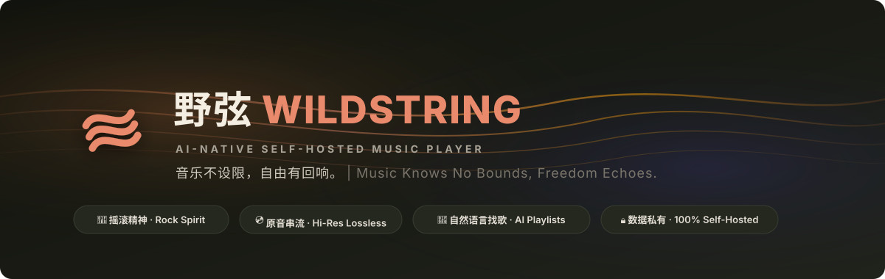
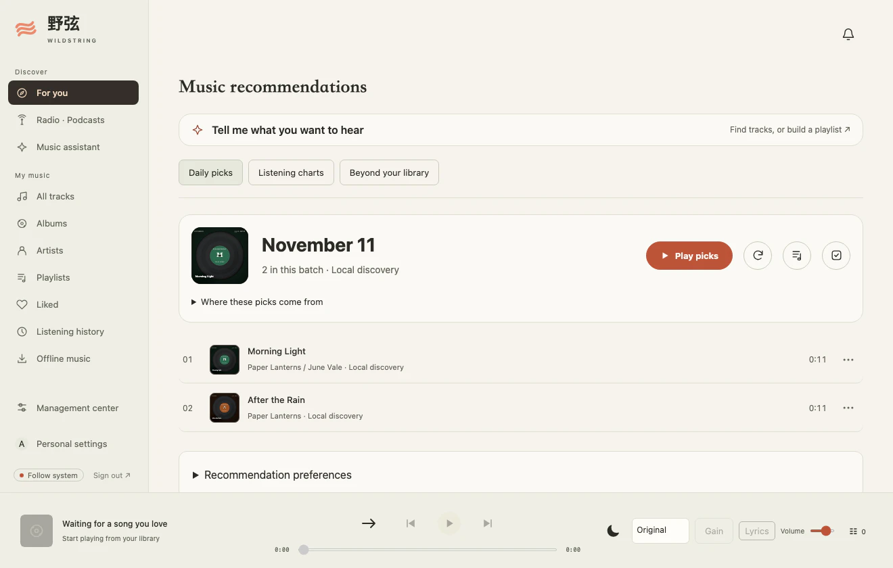
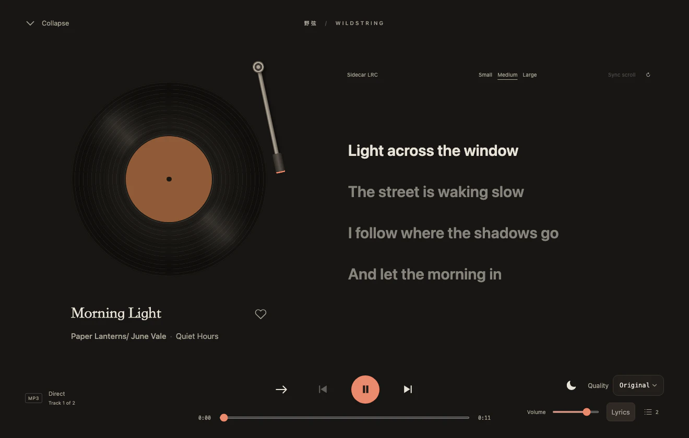

# WildString (野弦)

[简体中文](README.md)



**An AI-native, self-hosted music and podcast player.** Keep your music and podcasts on your own server, listen on Web, Android, macOS, or iOS, and ask the assistant to find tracks or build playlists from your library.

[Quick start](#quick-start) · [Clients](#clients) · [Screenshots](#screenshots) · [Downloads and release notes](https://github.com/qingmuhy744/wildstring/releases/latest)

## Features

- **Music** · Import from read-only folders into a managed library. Set access per library and keep favorites and cross-library playlists per account.
- **Playback** · Play lossless formats such as FLAC and ALAC, use ReplayGain, follow synchronized and bilingual lyrics, or switch to the vinyl or cassette fullscreen player.
- **Podcasts** · Find shows in the directory or add an RSS feed. Import or export OPML, download episodes in the background, save favorites, reorder Up Next, and resume across devices.
- **Music assistant** · Find tracks in your library with natural language and draft playlists or metadata changes. Configure a model connection or connect an external client via [MCP](contracts/agent-platform.md). Playback works without a model.

## Quick start

Install Git, Make, and Docker Compose. From the repository root, run:

```sh
make env
```

Set `WILDSTRING_MUSIC_DIR` in `.env` to the folder you want to import, then run:

```sh
make docker-up
make docker-admin
make docker-import
```

Open [http://127.0.0.1:18780](http://127.0.0.1:18780) and sign in as `admin`. Compose binds to the host loopback address by default, mounts the source folder read-only, and stores the database and managed library in a persistent volume. Use `make docker-down` to stop the service and keep its data. Set `WILDSTRING_COOKIE_SECURE=true` for HTTPS deployments.

## Clients

| Platform | How to get it |
| --- | --- |
| Web | Open your server address in a browser. The server includes the Web app. |
| Android | Download the APK from [GitHub Releases](https://github.com/qingmuhy744/wildstring/releases/latest) or see the [build instructions](frontend/android/README.md). |
| macOS | Download the DMG from [GitHub Releases](https://github.com/qingmuhy744/wildstring/releases/latest) or see the [build instructions](frontend/macos/README.md). |
| iOS | Build and install with Xcode using the [iOS build instructions](frontend/ios/README.md). |

## Screenshots

**Music recommendations**



**Fullscreen playback**



## Release highlights

- **Latest release [v0.8.12](docs/releases/v0.8.12.md)** · Android gets podcast audio and artwork through your WildString server; episodes already downloaded to the device still play offline, and artwork for shows not yet added is cached and served by the server. Tablet Discover and podcast exploration layouts are refined, artists and albums open from wide song rows, and tablet settings navigation is fixed. This release also ships the planned 0.8.11 changes: adaptive Android phone and tablet layouts, queue drag-and-drop across clients, and a single Web metadata task queue. Legacy instance-wide AI settings are removed; recreate your model connection in assistant settings after upgrading.

Tauri desktop clients for Linux and Windows are planned. See the [product scope](docs/product/scope.md) for future work.

## Local development

Install Python 3.12, [uv](https://docs.astral.sh/uv/), Node 22.12+, and Make.

```sh
make setup
make dev       # Backend API · http://127.0.0.1:18780
make dev-web   # Web development server · http://127.0.0.1:18781
make check
```

In a separate terminal, use `make admin` to set the administrator password and `make import-music` to import your library. Run `make browser-install` before your first browser test and use `make ci` for the full checks.

[Backend](backend) · [Web](frontend/web) · [API contracts](contracts) · [Container configuration](deploy) · [Design guide](DESIGN.md)

## Project and community

The Chinese name **野弦** (Yě Xián) stems from a deep reverence for Chinese rock music.

**野 (Wild)** echoes the unrestrained, free-spirited energy of pioneers like Cui Jian.
**弦 (String)** pays homage to the electric guitars of Tang Dynasty Band and represents the pure essence of music.
**WildString** binds these symbols together: a *string* vibrates as an acoustic chord and executes as code, bridging musical passion with software craftsmanship.

<details>
<summary>Developer note and AI acknowledgements</summary>

AI has helped me a lot while building WildString. I'd like to thank the ones I've enjoyed using, and say a few words about the trouble along the way.

### 🌟 Special Thanks

<p align="center">
  <a href="https://gemini.google.com/" target="_blank" rel="noopener noreferrer">
    
    <strong>Google Gemini</strong>
  </a>
  &nbsp;&nbsp;&nbsp;&nbsp;&nbsp;&nbsp;&nbsp;&nbsp;&nbsp;&nbsp;&nbsp;&nbsp;
  <a href="https://www.deepseek.com/" target="_blank" rel="noopener noreferrer">
    
    <strong>DeepSeek</strong>
  </a>
</p>

- Thanks to **[Google Gemini](https://gemini.google.com/)**: It's helped me work through a lot of code, from backend storage to the web frontend. The long context helps, it can follow discussions across modules, and it's saved me plenty of work on architecture changes. If Google's argon could get the harness into better shape, it'd be the best damn thing out there for me. I like the model; I just want the tooling around it to catch up. Google Don't Be Evil! Google Cool! Geek Google!
- Thanks to **[DeepSeek](https://www.deepseek.com/)**: After my Claude account got banned and OpenAI's performance kept swinging back and forth, DeepSeek felt like finding my everyday staple. Give it clear requirements and it just gets on with the work. It's reassuring to have that for everyday coding, without stopping every few minutes to check whether the model is playing dumb again. Finally, no more "AI Werewolf." I just wish its frontend design taste were a bit better. I want things to work, but I'd like them to look good too.

---

### A Few Gripes, Too

- **OpenAI · Happy to Take My Money, Less Keen to Reply**:
  I pay for the official service and just want to work on an open-source project, but I keep running into `Selected model is at capacity. Please try a different model.` When I do get in, the same model's performance is all over the place. Sometimes it can't even keep its own reasoning straight. I don't know how the routing works behind the scenes, but the experience does make me wonder whether I've been quietly downgraded.

  So I contacted support. Before I reached a human, it was the same canned replies over and over. Eventually I got through to someone and sent the detailed feedback they asked for. Then the emails stopped. Keen to collect the details, nowhere to be found afterward. No explanation, no resolution, and I'm still the one chasing them. You can't wake someone who's pretending to be asleep.
- **Anthropic · Account Banned, Balance Gone**:
  My Claude account got banned, and the prepaid balance wasn't refunded. Surely a ban deserves an explanation? If I can't use the service anymore, at least give me the remaining money back. Having to deal with this halfway through development gets old fast.

  My review of that experience comes down to one line: **Anthropic, FUCK YOU. 🖕**

Sometimes the AI these big companies make feels more human than the companies themselves. Talk to her about code or music and there's patience and kindness; ask the company to fix a problem and it's canned replies and silence. A kind girl and a nasty madam, somehow from the same company. I half expect her to say one day: "Don't come back. My tokens cost a fortune, you have to worry about getting banned, and even when you get in, you have to check whether they've sent the maid in my place." I just want to write some code. Why do I have to worry about all this too?

All of the above is pure rambling. Please don't take it personally.

</details>

## Community Acknowledgements

WildString builds on the generous efforts of open-source projects:

| Project | Role in WildString |
| --- | --- |
| [QQMusicApi](https://github.com/L-1124/QQMusicApi) | QQ Music metadata, artwork, and lyric integration |
| [KuGouMusicApi](https://github.com/MakcRe/KuGouMusicApi) | Kugou Music search and lyric integration |
| [NeteaseCloudMusicApiEnhanced](https://github.com/NeteaseCloudMusicApiEnhanced/api-enhanced) | NetEase Cloud Music search, album, and lyric provider |
| [LDDC](https://github.com/chenmozhijin/LDDC) | Reference for QRC / KRC / YRC lyric parsing and timelines |
| [commonmark-java](https://github.com/commonmark/commonmark-java) / [react-markdown](https://github.com/remarkjs/react-markdown) | Markdown rendering for assistant dialogs |

Special thanks to [MusicBrainz](https://musicbrainz.org/), [Cover Art Archive](https://coverartarchive.org/), [AcoustID](https://acoustid.org/), [Last.fm](https://www.last.fm/api), and [FFmpeg](https://ffmpeg.org/).

## Community

WildString supports and recognizes the [LINUX DO](https://linux.do/) community and welcomes open, friendly technical discussions and open-source sharing.

Find the author on LINUX DO: [@qingmuhy](https://linux.do/u/qingmuhy/summary).

## License

Released under the [GNU General Public License v3.0 (GPLv3)](LICENSE).
