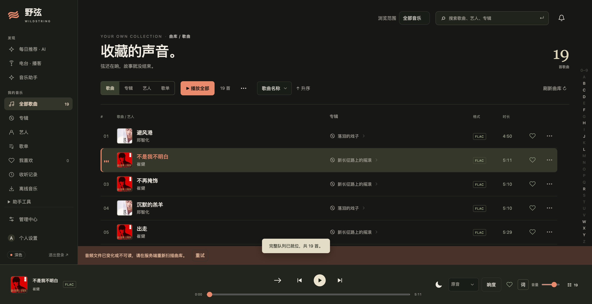
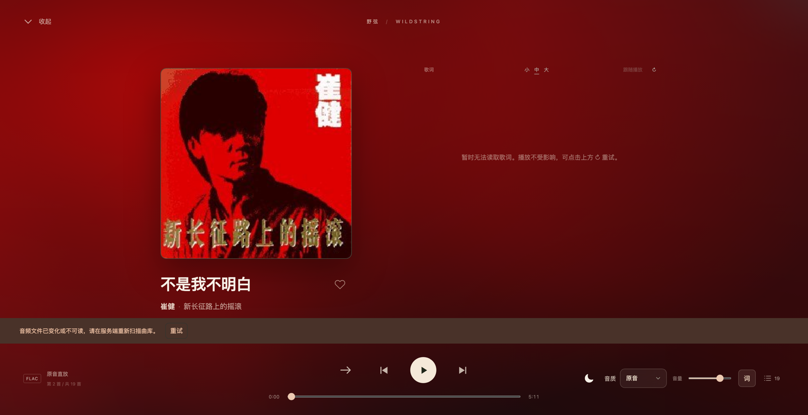

<div align="center">

<p>
  <a href="README.md">中文</a> | <strong><a href="README.en.md">English</a></strong>
</p>

[](https://github.com/qingmuhy744/wildstring)

# WildString (野弦)

**An AI-Native, Self-Hosted Personal Music Player.**
Revisit your curated music collection through natural language search, contextual playlist curation, and bit-perfect playback.

> *“Music knows no bounds, freedom echoes.”*

[](https://github.com/qingmuhy744/wildstring/releases/latest)
[](https://github.com/qingmuhy744/wildstring/actions)
[](https://github.com/qingmuhy744/wildstring/security/code-scanning)
[](docs/product/scope.md)
[](docs/product/scope.md)
[](frontend/web)
[](frontend/macos)
[](frontend/ios)
[](frontend/android)
[-FFC107.svg?logo=tauri&logoColor=white)](#roadmap)
[](backend)
[](backend/src/wildstring/database.py)
[](LICENSE)

</div>

---

## Acknowledgements & Developer Note

AI has helped me a lot while building WildString. I'd like to thank the ones I've enjoyed using, and say a few words about the trouble along the way.

### 🌟 Special Thanks

<p align="center">
  <a href="https://gemini.google.com/" target="_blank" rel="noopener noreferrer">
    
    <strong>Google Gemini</strong>
  </a>
  &nbsp;&nbsp;&nbsp;&nbsp;&nbsp;&nbsp;&nbsp;&nbsp;&nbsp;&nbsp;&nbsp;&nbsp;
  <a href="https://www.deepseek.com/" target="_blank" rel="noopener noreferrer">
    
    <strong>DeepSeek</strong>
  </a>
</p>

- Thanks to **[Google Gemini](https://gemini.google.com/)**: It's helped me work through a lot of code, from backend storage to the web frontend. The long context helps, it can follow discussions across modules, and it's saved me plenty of work on architecture changes. If Google's argon could get the harness into better shape, it'd be the best damn thing out there for me. I like the model; I just want the tooling around it to catch up. Google Don't Be Evil! Google Cool! Geek Google!
- Thanks to **[DeepSeek](https://www.deepseek.com/)**: After my Claude account got banned and OpenAI's performance kept swinging back and forth, DeepSeek felt like finding my everyday staple. Give it clear requirements and it just gets on with the work. It's reassuring to have that for everyday coding, without stopping every few minutes to check whether the model is playing dumb again. Finally, no more "AI Werewolf." I just wish its frontend design taste were a bit better. I want things to work, but I'd like them to look good too.

---

### A Few Gripes, Too

- **OpenAI · Happy to Take My Money, Less Keen to Reply**:
  I pay for the official service and just want to work on an open-source project, but I keep running into `Selected model is at capacity. Please try a different model.` When I do get in, the same model's performance is all over the place. Sometimes it can't even keep its own reasoning straight. I don't know how the routing works behind the scenes, but the experience does make me wonder whether I've been quietly downgraded.

  So I contacted support. Before I reached a human, it was the same canned replies over and over. Eventually I got through to someone and sent the detailed feedback they asked for. Then the emails stopped. Keen to collect the details, nowhere to be found afterward. No explanation, no resolution, and I'm still the one chasing them. You can't wake someone who's pretending to be asleep.
- **Anthropic · Account Banned, Balance Gone**:
  My Claude account got banned, and the prepaid balance wasn't refunded. Surely a ban deserves an explanation? If I can't use the service anymore, at least give me the remaining money back. Having to deal with this halfway through development gets old fast.

  My review of that experience comes down to one line: **Anthropic, FUCK YOU. 🖕**

Sometimes the AI these big companies make feels more human than the companies themselves. Talk to her about code or music and there's patience and kindness; ask the company to fix a problem and it's canned replies and silence. A kind girl and a nasty madam, somehow from the same company. I half expect her to say one day: "Don't come back. My tokens cost a fortune, you have to worry about getting banned, and even when you get in, you have to check whether they've sent the maid in my place." I just want to write some code. Why do I have to worry about all this too?

All of the above is pure rambling. Please don't take it personally.

---

## Screenshots & Visuals

<div align="center">





</div>

---

## Origins of the Name

The Chinese name **野弦** (Yě Xián) stems from a deep reverence for Chinese rock music.

**野 (Wild)** echoes the unrestrained, free-spirited energy of pioneers like Cui Jian.
**弦 (String)** pays homage to the electric guitars of Tang Dynasty Band and represents the pure essence of music.
**WildString** binds these symbols together: a *string* vibrates as an acoustic chord and executes as code, bridging musical passion with software craftsmanship.

---

## Recent Highlights

- **v0.8.6**: Mac server switching with separate queues; multiple connection routes and local server aliases on Mac, iOS, and Android; server naming, access policies, and MCP setup guides on Web; unavailable-track indicators and playback filtering across clients; improvements to Mac settings and podcast speed controls, Android navigation and Daily Mix, and bilingual Web UI. See [v0.8.6 Release Notes](docs/releases/v0.8.6.md); check the corresponding Actions runs for validation and release status.
- **v0.8.5**: Deep fix for album metadata modification & cover upload pipeline; podcast zero-reference cleanup preview modal & breakdown; Apple playback dynamic duration sync; management center & download cards dual-theme refinement; complete wiki overhaul with fresh web captures; dependency & CI/CD upgrades. See [v0.8.5 Release Notes](docs/releases/v0.8.5.md).
- **v0.8.4**: Unified cross-platform versioning to 0.8.4; reinforced bilingual release automation and resilient test gates. See [v0.8.4 Release Notes](docs/releases/v0.8.4.md).
- **v0.8.3**: Podcast regional top charts discovery and preview-before-follow across Web, Android, and Mac; direct raw audio downloads; content vs. settings sidebar re-organization; wide folder picker. See [v0.8.3 Release Notes](docs/releases/v0.8.3.md).
- **v0.8.2**: All-new Native macOS Client (desktop floating lyrics, menu bar mini-player, AI assistant); Apple Podcasts multi-region parallel search & deduplication; OPML import/export. See [v0.8.2 Release Notes](docs/releases/v0.8.2.md).
- **v0.8.1**: Podcast stream proxy security hardening (sandbox & XSS defense); AI assistant configurable turns and automated thread title synthesis; cross-platform responsiveness. See [v0.8.1 Release Notes](docs/releases/v0.8.1.md).
- **v0.8.0**: Multi-library support with granular user authorization; personalized podcast feeds & offline downloads; dedicated podcast playback overlay. See [v0.8.0 Release Notes](docs/releases/v0.8.0.md).
- **Ongoing Refinements**:
  - Wide preview modal in Podcast Shared Audio Management to review zero-reference cleanup candidates before recycling disk space;
  - Restrained warm, high-contrast visual redesign for download task queues and completion cards across dark and light themes;
  - Bit-perfect seeking on lyric line clicks, and seamless in-app client navigation for Brand logo to preserve continuous background audio playback.

---

## Core Capabilities

- **🎧 Pure, Bit-Perfect Audio**: Native bitstream playback for FLAC, WAV, APE, ALAC, MP3, AAC, OGG, Opus; optional ReplayGain loudness normalization.
- **🧠 AI-Native Curation**: Search tracks, generate thematic playlists, and explore sonic connections using natural language grounded strictly in your verified local library.
- **🏠 100% Self-Hosted & Local-First**: Import folders remain strictly read-only; managed libraries and metadata live locally in SQLite with zero telemetry or audio leakage.
- **📻 Podcasts & Radio Streams**: Subscribe to RSS feeds, orchestrate background downloads, and enjoy automatic zero-reference garbage collection.
- **📜 Rich Synchronized Lyrics**: Synced word-by-word LRC display, side-by-side bilingual lyrics, dynamic album color extraction, and nostalgic vinyl / cassette playback styles.
- **📱 True Multi-Platform**: Responsive modern Web frontend alongside native Android (Kotlin / Jetpack Compose / Media3) and iOS (SwiftUI) applications.

---

## Roadmap

WildString is dedicated to delivering a premier, cross-platform personal music streaming and curation experience. Our immediate roadmap ahead:

- [ ] **Native Desktop Client with Tauri + Rust**:
  - **Ubuntu (Linux) & Windows First**: Priority release of official Linux (.deb / AppImage) and Windows (.msi / portable) desktop distributions;
  - **Ultra-Lightweight & Zero-Bloat**: Bypassing heavy Electron frameworks in favor of Tauri v2 and Rust, ensuring tiny bundle sizes and instant sub-second startup;
  - **OS-Level Media Integration**: Native bindings for Linux MPRIS and Windows SMTC, supporting global multimedia keys, system tray control, lock-screen widgets, and native toasts;
  - **Audiophile Low-Latency Output**: Utilizing modern Rust audio crates (cpal / rodio) to explore bit-perfect PipeWire / ALSA and exclusive WASAPI audio pipelines.
- [ ] **LAN Smart Synchronization & P2P Caching**: High-speed, zero-cellular local network sync and background pre-fetching between mobile and desktop devices.
- [ ] **Deep Multimodal & Contextual Semantic Understanding**: Advancing local AI reasoning over musical arrangement, harmonic mood contours, and lyrical subtext.

---

## Local Development

Prerequisites: Git, [uv 0.13.1+](https://docs.astral.sh/uv/), Node 22.12+, and Make.

```sh
make setup           # Install locked dependencies, initialize .env & hooks
make dev             # Backend API: http://127.0.0.1:18780
make dev-web         # Web UI: http://127.0.0.1:18781
make import-music    # Copy from read-only intake into managed library
make scan            # Rescan managed tracks
make admin           # Interactively set admin password
make browser-install # Install Playwright Chromium for testing
make ci              # Linting, backend tests, web build & lockfile check
```

---

## Docker Deployment

```sh
make docker-up       # Build, launch, and wait for health check
make docker-test     # Test backend audio decoding with FFmpeg in container
make docker-smoke    # Smoke test API, Web, read-only permissions & storage
make docker-import   # Intake audio files into persistent volume /data/library
make docker-scan     # Rescan library in container
make docker-admin    # Set container admin password
make docker-status   # Inspect container status
make docker-down     # Stop containers (preserves data volumes)
```

Access your instance at [http://127.0.0.1:18780](http://127.0.0.1:18780). For production HTTPS setups, remember to set `WILDSTRING_COOKIE_SECURE=true`.

---

## Directory Structure

```text
backend/          Python 3.12, FastAPI backend, tests, and uv.lock
frontend/web/     React 19 + TypeScript + Vite web app
frontend/macos/   SwiftUI + AppKit native macOS app
frontend/android/ Kotlin + Jetpack Compose + Media3 native app
frontend/ios/     SwiftUI native iOS app
contracts/        API contracts and structured schemas
docs/             Architecture designs, product specs, and guides
deploy/           Production Dockerfile and Docker Compose manifests
scripts/          Dev setup, git hooks, and packaging scripts
```

---

## Community Acknowledgements

WildString builds on the generous efforts of open-source projects:

| Project | Role in WildString |
| --- | --- |
| [QQMusicApi](https://github.com/L-1124/QQMusicApi) | QQ Music metadata, artwork, and lyric integration |
| [KuGouMusicApi](https://github.com/MakcRe/KuGouMusicApi) | Kugou Music search and lyric integration |
| [NeteaseCloudMusicApiEnhanced](https://github.com/NeteaseCloudMusicApiEnhanced/api-enhanced) | NetEase Cloud Music search, album, and lyric provider |
| [LDDC](https://github.com/chenmozhijin/LDDC) | Reference for QRC / KRC / YRC lyric parsing and timelines |
| [commonmark-java](https://github.com/commonmark/commonmark-java) / [react-markdown](https://github.com/remarkjs/react-markdown) | Markdown rendering for assistant dialogs |

Special thanks to [MusicBrainz](https://musicbrainz.org/), [Cover Art Archive](https://coverartarchive.org/), [AcoustID](https://acoustid.org/), [Last.fm](https://www.last.fm/api), and [FFmpeg](https://ffmpeg.org/).

---

## License

Released under the [GNU General Public License v3.0 (GPLv3)](LICENSE).
