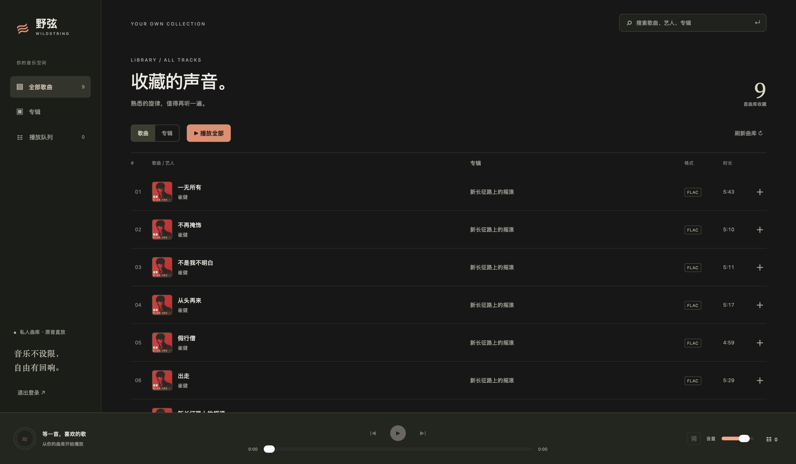
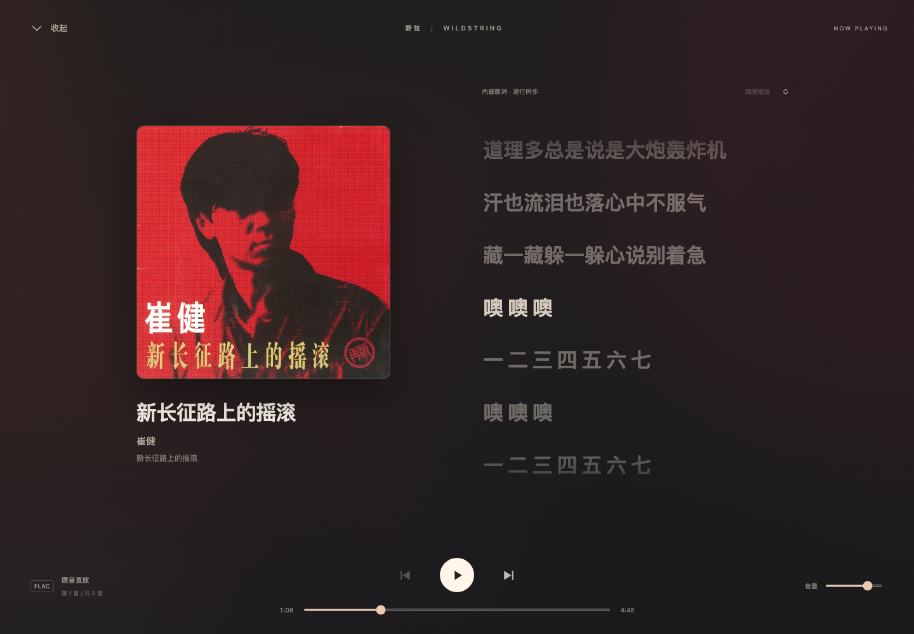

# 野弦 WildString

0.5.12 更新：核对页支持拒绝候选；修复 Web 分区滚动，合并重复查询候选并标明专辑版本。见[发布说明](docs/releases/v0.5.12.md)。

0.5.4 更新：维护依赖安全版本，精简数据源插件依赖；助手回答支持 Markdown 排版、逐步显示和中断后的部分结果恢复。见[发布说明](docs/releases/v0.5.4.md)。

0.5.2 更新：自定义头像、推荐临时歌单、紧凑对话菜单、角落通知与跨设备轻提示，整理导航并修复主题配色和面板滚动；新 AI 连接默认 8192 Token / low / 90 秒，Android 歌词默认 2 秒恢复跟随并可调整。见[发布说明](docs/releases/v0.5.2.md)。

[](https://github.com/qingmuhy744/wildstring/actions/workflows/ci.yml)

**AI native 的私人音乐播放器。** 从自己的音乐收藏出发，用自然语言找歌、生成歌单，让收藏的音乐有新的回响。

> 音乐不设限，自由有回响。





## 名字的来处

「野弦」带着一点对中国摇滚的偏爱。

**野**，呼应崔健音乐中自由、不受拘束的气质；**弦**，呼应唐朝乐队的吉他，也代表音乐本身。**WildString** 延续这份意象，而 String 同时是琴弦与程序里的字符串，把热爱的音乐和写代码这件事连在一起。

我们希望野弦让用户保有自己的曲库、整理方式和选择，让 AI 帮助发现与理解音乐。这个名字表达个人喜好与致意，不代表与相关音乐人或乐队存在合作关系。

## 现在做什么

第一阶段使用 **Python 3.12 / FastAPI + React / TypeScript**，提供自托管服务与网页端。MVP 主线：导入本地曲库 → 浏览与播放 → 查看本地歌词 → 自然语言找歌 → 预览、保存并播放 AI 歌单。

当前已有工程基座、SQLite 托管曲库、只读源导入与目录整理、本地用户登录、管理员/普通用户、歌曲/专辑/艺人视图、封面与本地滚动歌词，以及原音串流和网页队列。支持全屏播放、下一首播放、队列排序、♥ 收藏、普通/规则歌单与收听次数/时长记录。已增加管理入口、网页导入/扫描、任务历史和单曲元数据覆盖编辑；AI API 配置与连接测试已接入设置。现已接入自动发现、导入预检、待整理，以及 WAV/CUE 到逐曲 FLAC 的校验转换，见 [自动导入](contracts/automatic-import.md)。**已有文件标签写回、文件移动和无人值守应用仍待实现。** 详见 [MVP 范围](docs/product/scope.md)。

0.2.2 增加多创作人编辑与角色筛选、MusicBrainz / Last.fm 资料建议、CAA 封面候选和按用户授权的 Last.fm 收听同步；Web 与 Android 收藏先反馈、失败恢复。管理员在网页设置联网来源和代理，代理可跟随 Docker 的 `HTTP_PROXY` / `HTTPS_PROXY` / `ALL_PROXY` / `NO_PROXY`。功能入口、真实账号验证边界见 [联网资料与 Last.fm](contracts/metadata-providers.md)。

0.3.0 包含原未发布 0.2.3 的 Android / Web 封面、黑胶和磁带播放样式，默认封面并记住本机选择；同步改善 Android 系统栏衔接与播放进度条配色。切换样式复用当前音频，拟物动画随播放、可见性和系统减少动态效果设置启停。范围与验证状态见 [播放页样式](docs/product/player-styles-0.2.3.md)，正式可下载版本以 Releases 为准。

本版同时接入可选的 AcoustID 指纹识别，并提供单曲、专辑和整库的「更新元数据」。网页可拖动设置 MusicBrainz / Last.fm 的推荐优先级；更新先生成建议，确认后应用。AcoustID 应用 Key 在管理设置中填写，只保存于服务端私有配置。入口、缺失／全部更新方式和验证边界见 [元数据更新](docs/product/metadata-refresh-0.2.3.md)。

0.3.0 补齐 Android 普通／规则歌单编辑、多选、创作角色和收听统计，以及管理员元数据、歌词打点、待整理与任务入口。两端加入整集合跨页播放、睡眠定时、完整原音离线下载、每日推荐、自然语言找歌／歌单预览和显式跨设备接续；网页按账号恢复队列与进度，恢复时暂停，支持循环与随机。入口、容量和断网限制见 [手机使用闭环](docs/product/mobile-completion-0.3.0.md)。

0.3.1 增加网页联网检测与元数据任务进度，Android 可保存多个服务端，独立切换与退出登录，并提供 GitHub Release 更新检查及仓库入口。使用方式、升级与验证边界见 [0.3.1 更新说明](docs/releases/v0.3.1.md)。

0.3.2 支持从歌曲菜单和播放页直接查看所属专辑，统一两端歌曲操作图标、间距与视觉对齐，跳转时保持当前播放和队列。见 [0.3.2 更新说明](docs/releases/v0.3.2.md)。

0.3.3 将 Android 与 Web 曲库改为连续滚动，加入数字／拼音首字母定位，优化专辑与歌曲列表空间；歌曲列表可在设置中选择小、中（推荐）、大，默认中档并记住本机选择。修复播放页进入专辑后的返回路径及统计排序。见 [0.3.3 更新说明](docs/releases/v0.3.3.md)。

每日推荐默认仅使用本地收藏、收听记录与真实元数据，当天保持稳定，可主动换批并反馈偏好。AI 与 Last.fm 增强默认关闭；显式 AI 查询仅发送有界候选元数据，结果须对应本地真实曲目，预览后确认保存；模型不可用会明确回退为本地检索。推荐不分析或上传原音频。

服务端元数据整理将支持手动/批量编辑、差异预览和显式写回，减少使用 mp3tag 前后下载与上传整首音频的重复传输，见 [整理设计](docs/architecture/metadata-repair.md)。

0.4.0 统一助手、发现和每日推荐的模型连接与额度，按账号结合个人偏好、本服热门和本地探索；另提供可选 Last.fm 库外新音乐建议，便于手动下载与收藏，见[推荐与发现](docs/architecture/recommendations.md)。同时加入内置多轮助手、MCP、站内批准的草案、持久巡检与定时计划、站内通知及可选 Telegram；统一模型／来源网络策略和脱敏日志诊断。同步增加歌单自动离线、下载音质与网络设置、三种跨设备接续模式、任务自动归档和播放器改进。新功能需要同步升级服务端；使用、验证及真机边界见 [0.4.0 发布说明](docs/releases/v0.4.0.md) 与 [Agent / MCP 配置](docs/architecture/agent-platform.md)。

0.5.0 增加聊天联网检索、可点击来源、长对话摘要与可管理的长期记忆，支持 Chat Completions / Responses 及供应商差异适配。同步包含原 0.4.1 的手动 AI 巡检、历史管理修复。请同时升级服务端与 App；搜索需在“联网与记忆”中配置并启用，详见 [0.5.0 发布说明](docs/releases/v0.5.0.md)。

## 本地开发

准备 Git、[uv 0.13.1+](https://docs.astral.sh/uv/)、Node 22.12+ 和 Make；容器运行需要 Docker Compose。

```sh
make setup         # 安装锁定依赖、创建 .env、安装 Git hook
make dev           # 终端一：API http://127.0.0.1:18780
make dev-web       # 终端二：React http://127.0.0.1:18781
make import-music  # 从只读源复制到托管库，整理目录并入库
make scan          # 重扫托管副本
make admin         # 首次交互设置 admin 密码；修改密码会撤销会话
make browser-install # 首次安装浏览器测试使用的 Chromium
make ci            # 提交检查、后端测试、Web 构建、锁文件核验
```

`make setup` 保留已有 `.env`。通过 `WILDSTRING_MUSIC_DIR` 指向自己的音乐目录；个人曲库、运行数据与模型密钥不入库。

原生 macOS／Linux 后端使用指纹识别时需安装 [Chromaprint 的 fpcalc](https://acoustid.org/chromaprint)，运行 `make fingerprint-check` 核对。Docker 镜像已包含该工具，不需要额外容器；未启用指纹识别时，普通资料查询与播放仍可使用。

仓库根目录 `data/` 已从 Git 和 Docker 构建上下文排除，可存放本地测试音乐。导入使用 `make import-music`；托管副本默认位于 `runtime/library/`。全量重扫使用 `make scan SCAN_ARGS=--full`。按“专辑艺人/专辑/CD01/01 - 歌名”整理副本，保留原件；重复导入不覆盖已有修改，见 [托管规则](contracts/managed-library.md)。

## Docker

```sh
make docker-up       # 构建、启动并等待健康检查
make docker-test     # 用容器内 FFmpeg 完整验证后端与无损分轨
make docker-smoke    # 实测 API、Web、FFmpeg、非 root 与只读音乐目录
make docker-import   # 从只读源导入到持久卷 /data/library
make docker-scan     # 重扫托管副本
make docker-admin    # 首次设置容器的 admin 密码
make docker-status
make docker-down     # 停止服务，保留数据卷
```

容器内包含 Web，访问 [本地野弦](http://127.0.0.1:18780)。默认仅绑定回环地址，导入源只读挂载，托管曲库和运行数据放在持久卷。首次设置管理员后登录；可选在未跟踪的 `.env` 提供 `WILDSTRING_ADMIN_PASSWORD` 仅初始化首次密码，重置使用 Make 命令。HTTPS 部署设置 `WILDSTRING_COOKIE_SECURE=true`。

原音播放遵循浏览器的编码支持；不能解码时有错误提示，可明确选择 AAC 对无损音源转码，MP3/AAC 等有损音源保持直放，见 [AAC 播放](contracts/playback-transcoding.md)。封面优先内嵌正面图片，再读同名图片或目录 cover/folder/front；人工编辑优先于文件歌词，同名 LRC 优先于内嵌歌词，点击底栏封面可展开全屏播放，支持逐行滚动与点击跳转；点击收起或按 Esc 返回，播放继续。见 [封面、专辑和歌词](contracts/local-library-assets.md)。收藏与歌单会持久保存，规则歌单支持按艺人、收藏、播放次数和累计收听等条件自动筛选；见 [个人曲库功能](contracts/personal-library.md)。网页队列、进度和播放模式按账号保存在当前浏览器；跨设备可选择关闭、询问或自动暂停恢复，仍保留手动共享与继续入口。见 [播放与认证接口](contracts/playback-auth-api.md)。管理功能与 AI 连接设置见 [曲库管理](contracts/library-management.md)。

网页支持浅色、深色和跟随系统；全屏背景按专辑封面取色。管理员可编辑歌词、跟随播放逐行打点并导出 LRC，见 [歌词制作](contracts/lyrics-editing.md)。管理员创建/停用用户、重置密码，所有用户可改自己的密码，收藏与歌单按用户隔离。Host 白名单默认关闭，启用前请核对访问主机；误配置后只能直接修改数据库关闭，见 [账号、权限与恢复](contracts/users-and-access.md)。

## 分支与提交规范

`main` 为默认集成分支，日常开发从最新 `main` 创建短期分支，通过 PR 合并；暂不设长期 `develop` 分支。

| 前缀 | 用途 | 示例 |
| --- | --- | --- |
| `feat/` | 新功能 | `feat/ai-playlists` |
| `fix/` | 缺陷修复 | `fix/audio-range` |
| `docs/` | 文档 | `docs/provider-research` |
| `chore/` | 工程、依赖、CI | `chore/update-python-deps` |
| `refactor/` | 保持行为的重构 | `refactor/library-scanner` |
| `test/` | 测试与测试样本 | `test/chinese-track-matching` |

主题使用简短英文小写与连字符；需要关联 Issue 时可用 `feat/123-ai-playlists`。一个分支聚焦一项工作，合并后删除。只有需要版本稳定维护时才使用 `release/0.1`，不为每次发布强制建立发布分支。

提交建议采用 `type(scope): description`，例如 `feat(ai): add playlist preview`、`docs: explain project naming`。PR 前运行 `make ci`；修改运行或部署行为时同时验证 Docker。

发布使用 `v0.1.0`、`v0.1.0-rc.1` 等 **Git 标签与 GitHub Release**，与开发分支分别管理。这些是协作约定，仓库级分支保护另行配置。

## CI/CD

- `main` 提交和 PR：检查、测试、Web 构建与容器实测。
- [Security and quality](https://github.com/qingmuhy744/wildstring/security)：CodeQL 安全与质量扫描、PR 依赖审查、Dependabot 更新、Android 依赖图及密钥保护；范围与套餐限制见 [GitHub 安全配置](docs/architecture/github-security.md)，漏洞请按 [安全政策](SECURITY.md) 私密报告。
- 推送 `vX.Y.Z` 标签：完整检查、Android 功能测试与正式包安装检查通过后，发布 amd64/arm64 镜像到 `ghcr.io/qingmuhy744/wildstring`，自动创建包含签名 APK、Web ZIP、QQ／酷狗／网易云数据源插件 ZIP、公开签名指纹与 `SHA256SUMS` 的 GitHub Release。
- 正式 Release 更新 `latest`；预发布保留独立版本标签。
- Android [Kotlin/Compose/Media3 原生客户端](frontend/android/README.md) 已接入真实曲库、后台播放与手机/平板歌词布局。显示名称「野弦」，正式包名 `com.wildstring.app`；签名 APK 从 [Releases](https://github.com/qingmuhy744/wildstring/releases) 直接下载。`make android-ci` 和独立 **Android APK** 工作流继续提供开发用 debug 包。IPA 和桌面安装包后续交付。

见 [开发与部署](docs/development.md)、[发布流程](docs/releasing.md) 和 [更新记录](CHANGELOG.md)。功能批次先写入「未发布」，核对后由用户确定版本号再更新 App。

## 目录

```text
backend/          Python 项目、src/wildstring、测试与 uv.lock
frontend/web/     React + TypeScript + Vite 与 package-lock.json
contracts/        后续 API 契约与结构化 AI 工具定义
docs/             产品、架构、调研、技术决策与工程说明
deploy/           Dockerfile 与 Compose
scripts/          初始化、全量 hooks 检查与发布打包
tests/fixtures/   后续使用的合法测试样本
```

[组件分工](docs/architecture/components.md) · [技术决策](docs/decisions/0001-python-web-foundation.md) · [AI／MCP／日志与通知开发计划](docs/product/agent-mcp-observability-notifications-plan.md)（待分阶段开发） · [原始讨论](docs/research/README.md)

## 致谢

感谢以下项目的作者、贡献者和维护者。野弦的数据源插件与歌词处理建立在这些社区工作的基础上：

| 项目 | 在野弦中的用途 |
| --- | --- |
| [QQMusicApi](https://github.com/L-1124/QQMusicApi) | QQ 音乐插件使用的歌曲、专辑、封面与歌词接口 |
| [KuGouMusicApi](https://github.com/MakcRe/KuGouMusicApi) | 酷狗插件内置的元数据与歌词接口模块 |
| [NeteaseCloudMusicApiEnhanced](https://github.com/NeteaseCloudMusicApiEnhanced/api-enhanced) | 网易云插件内置的元数据与歌词接口模块，亦感谢其上游 NeteaseCloudMusicApi 的贡献者 |
| [LDDC](https://github.com/chenmozhijin/LDDC) | QRC／KRC／YRC 歌词格式解析与逐字时间轴处理的参考 |
| [commonmark-java](https://github.com/commonmark/commonmark-java)／[react-markdown](https://github.com/remarkjs/react-markdown) | Android 与网页助手回答的 Markdown 解析及渲染 |

也感谢 [MusicBrainz](https://musicbrainz.org/)、[Cover Art Archive](https://coverartarchive.org/)、[AcoustID／Chromaprint](https://acoustid.org/)、[Last.fm](https://www.last.fm/api) 提供音乐资料、封面、音频指纹及收听记录服务，以及 [FFmpeg](https://ffmpeg.org/) 提供音频转换与响度分析能力。响度均衡与专辑／单曲调整的使用体验参考了 [foobar2000](https://www.foobar2000.org/) 的 ReplayGain 功能。

第三方项目保留各自的许可证与版权声明；插件中的上游来源、许可证及依赖说明见随包文件和[插件文档](docs/architecture/source-plugins.md)。

许可证沿用仓库已有的 [GPLv3](LICENSE)。
