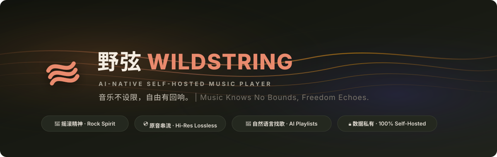
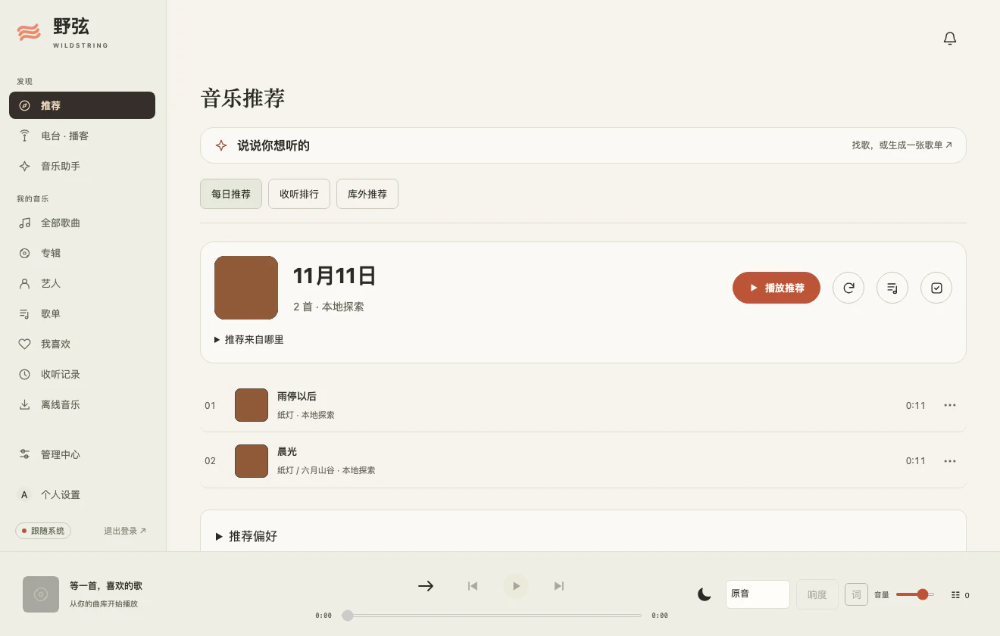
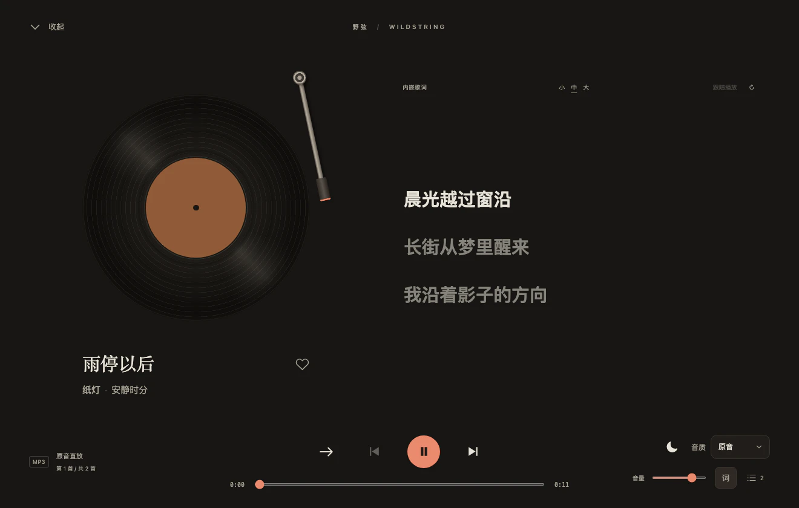

# 野弦 WildString

[English](README.en.md)



**AI-native 的自托管音乐与播客播放器。** 在自己的服务器上管理音乐与播客，用 Web、Android、macOS 或 iOS 收听，也可以让助手从曲库里找歌、生成歌单。

[快速开始](#快速开始) · [客户端](#客户端) · [界面预览](#界面预览) · [下载与发布说明](https://github.com/qingmuhy744/wildstring/releases/latest)

## 主要功能

- **音乐** · 从只读目录导入音乐，由服务器管理副本。支持多曲库、按用户授权、个人收藏和跨库歌单。
- **播放** · 支持 FLAC、ALAC 等无损格式与 ReplayGain。可查看同步歌词与双语歌词，也可以切换黑胶、卡带等全屏样式。
- **播客** · 通过目录搜索或 RSS 添加节目，支持 OPML 导入导出、后台下载、单集收藏、待播排序和跨端续听。
- **音乐助手** · 用自然语言检索真实曲目，生成歌单或元数据整理草案。可配置模型连接，也可通过 [MCP](contracts/agent-platform.md) 接入外部客户端。基础播放无需配置模型。

## 快速开始

准备 Git、Make 和 Docker Compose。在仓库根目录执行：

```sh
make env
```

在 `.env` 中将 `WILDSTRING_MUSIC_DIR` 指向音乐源目录，然后执行：

```sh
make docker-up
make docker-admin
make docker-import
```

打开 [http://127.0.0.1:18780](http://127.0.0.1:18780)，以 `admin` 登录。Compose 默认只监听宿主机回环地址，音乐源以只读方式挂载，数据库与托管曲库保存在持久卷中。`make docker-down` 停止服务并保留数据。通过 HTTPS 部署时设置 `WILDSTRING_COOKIE_SECURE=true`。

## 客户端

| 平台 | 使用方式 |
| --- | --- |
| Web | 浏览器打开服务地址，前端随服务器一起提供。 |
| Android | 从 [GitHub Releases](https://github.com/qingmuhy744/wildstring/releases/latest) 下载 APK，或查看[构建说明](frontend/android/README.md)。 |
| macOS | 从 [GitHub Releases](https://github.com/qingmuhy744/wildstring/releases/latest) 下载 DMG，或查看[构建说明](frontend/macos/README.md)。 |
| iOS | 使用 Xcode 构建并安装，见 [iOS 构建说明](frontend/ios/README.md)。 |

## 界面预览

**每日推荐**



**全屏播放**



## 版本动态

- **正式版 [v0.8.13](docs/releases/v0.8.13.md)** · **不兼容 0.8.12 及更早客户端**：服务端已移除 `/podcasts/inbox`，必须将服务器与四端客户端一同升级。每个用户只保留一份有序待播列表，原「稍后听」升级时接到队尾；新集默认加到队尾，去掉每节目 3 条上限。从节目点播放顺着节目，从待播点播放顺着列表。Android 打磨了播客播放器过渡、待播面板底部适配，并把新集规则收进「已关注」菜单。

Linux 和 Windows 的 Tauri 桌面客户端仍在规划中，见[产品范围](docs/product/scope.md#后置能力)。

## 本地开发

准备 Python 3.12、[uv](https://docs.astral.sh/uv/)、Node 22.12+ 和 Make。

```sh
make setup
make dev       # 后端 API · http://127.0.0.1:18780
make dev-web   # Web 开发服务器 · http://127.0.0.1:18781
make check
```

在另一个终端用 `make admin` 设置管理员密码、`make import-music` 导入曲库。首次运行浏览器测试前执行 `make browser-install`，完整检查使用 `make ci`。

[后端](backend) · [Web](frontend/web) · [接口契约](contracts) · [容器配置](deploy) · [视觉规范](DESIGN.md)

## 项目与社区

「野弦」带着一点对中国摇滚的偏爱。

**野**，呼应崔健音乐中自由、不受拘束的气质；**弦**，呼应唐朝乐队的吉他，也代表音乐本身。**WildString** 延续这份意象，而 String 同时是琴弦与程序里的字符串，把热爱的音乐和写代码这件事连在一起。

我们希望野弦让用户保有自己的曲库、整理方式和选择，让 AI 帮助发现与理解音乐。这个名字表达个人喜好与致意，不代表与相关音乐人或乐队存在合作关系。

<details>
<summary>开发者手记与 AI 工具致谢</summary>

野弦开发到现在，AI 帮了不少忙。好用的想认真说声谢谢，踩过的坑也想说两句。

### 🌟 特别致谢

<p align="center">
  <a href="https://gemini.google.com/" target="_blank" rel="noopener noreferrer">
    
    <strong>Google Gemini</strong>
  </a>
  &nbsp;&nbsp;&nbsp;&nbsp;&nbsp;&nbsp;&nbsp;&nbsp;&nbsp;&nbsp;&nbsp;&nbsp;
  <a href="https://www.deepseek.com/" target="_blank" rel="noopener noreferrer">
    
    <strong>DeepSeek 深度求索</strong>
  </a>
</p>

- 感谢 **[Google Gemini](https://gemini.google.com/)**：从后端存储到 Web 前端，陪我啃了不少代码。上下文长，跨模块讨论问题也接得住，改架构时确实省了很多事。Google 的 argon 要是能把 Harness 再做好点，对我来说就是最牛逼的了。模型用着喜欢，也盼着配套工具能跟上。Google Don't Be Evil！Google Cool！Geek Google！
- 感谢 **[DeepSeek](https://www.deepseek.com/)**：Claude 封了号，OpenAI 的表现又时好时坏，那段时间用上 DeepSeek，感觉就是找到了日常口粮。要求说清楚，它就库库干活，日常写代码用着踏实。不用写一会儿就停下来试探模型是不是又在演我，终于不用玩“模型狼人杀”了。就是前端审美要能再好点就好了，活能干，脸也想要。

---

### 也吐槽几句

- **OpenAI · 钱照收，问题没人回**：
  我付费订阅官方服务，想好好写个开源项目，结果经常撞上 `Selected model is at capacity. Please try a different model.`。好不容易能用了，同一个模型的表现又忽上忽下，有时连前后逻辑都接不上。我不知道后台到底怎么路由的，但用起来确实让我怀疑自己是不是被悄悄降了档。

  为这事找客服，转到真人之前，一直收到的都是那几套话。后来好不容易联系上真人，我也按要求把详细反馈整理交了过去，结果邮件就没下文了。收集问题的时候挺积极，收完就装死。问题没解释，事情没解决，还得我接着追问。你永远叫不醒一个装睡的人。
- **Anthropic · 号封了，余额也没了**：
  Claude 账号被封，预付的钱也没退。封号总得给个说法吧？不让我用了，剩下的钱倒是退啊。开发写到一半先得处理这些破事，谁受得了。

  至于这段体验的评价，就一句：**Anthropic, FUCK YOU. 🖕**

有时候真觉得，现在大公司的 AI，比大公司本身更像个人。跟她聊代码、聊音乐，能感受到耐心和善意；一转头找公司解决问题，就只剩套话和装死。善良的她，恶毒的龟婆，居然能出自同一家公司。就怕哪天她来一句：“下次别来了，我 Token 这么贵，你还得提防封号，见了面还得确认是不是丫鬟来顶包。”我就想写个代码，怎么还得操这些心。

以上内容纯属胡言乱语，切勿对号入座。

</details>

## 开源社区致谢

野弦的数据源插件与歌词处理建立在以下开源项目与社区贡献者的辛勤付出之上：

| 项目 | 在野弦中的用途 |
| --- | --- |
| [QQMusicApi](https://github.com/L-1124/QQMusicApi) | QQ 音乐插件使用的歌曲、专辑、封面与歌词接口 |
| [KuGouMusicApi](https://github.com/MakcRe/KuGouMusicApi) | 酷狗插件内置的元数据与歌词接口模块 |
| [NeteaseCloudMusicApiEnhanced](https://github.com/NeteaseCloudMusicApiEnhanced/api-enhanced) | 网易云插件内置的元数据与歌词接口模块，亦感谢其上游贡献者 |
| [LDDC](https://github.com/chenmozhijin/LDDC) | QRC／KRC／YRC 歌词格式解析与逐字时间轴处理的参考 |
| [commonmark-java](https://github.com/commonmark/commonmark-java)／[react-markdown](https://github.com/remarkjs/react-markdown) | Android 与网页端助手回答的 Markdown 解析与渲染 |

同时衷心感谢 [MusicBrainz](https://musicbrainz.org/)、[Cover Art Archive](https://coverartarchive.org/)、[AcoustID](https://acoustid.org/)、[Last.fm](https://www.last.fm/api) 及 [FFmpeg](https://ffmpeg.org/) 提供的音频与元数据能力支持。

## 社区与交流

野弦支持并认可 [LINUX DO](https://linux.do/) 社区，欢迎开放、友善的技术交流与开源分享。

作者的 LINUX DO 账号：[@qingmuhy](https://linux.do/u/qingmuhy/summary)。

## 许可证

本项目沿用 [GNU General Public License v3.0 (GPLv3)](LICENSE)。
