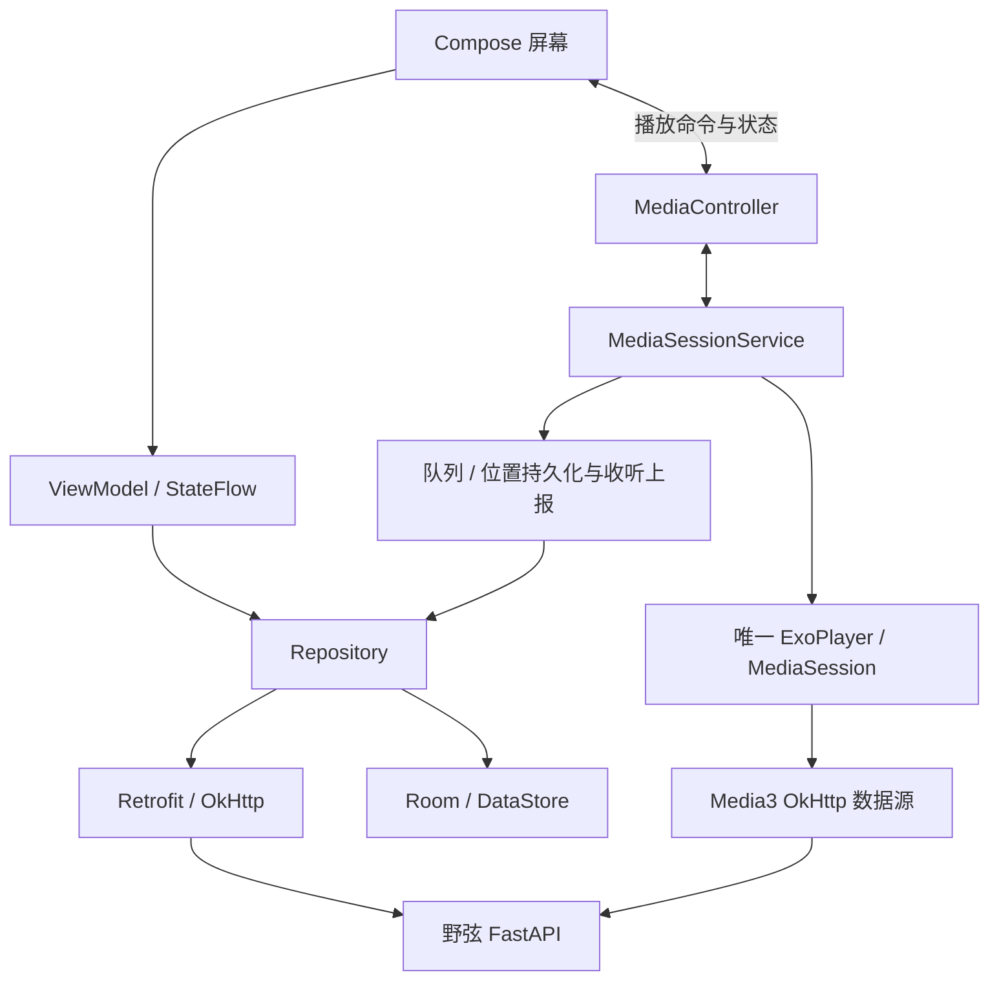

# ADR 0003：Android 原生客户端

日期：2026-10-15。状态：技术方向已落地到 `frontend/android` 首个原生测试版，构建与设备验证结果分别记录。

## 决策

Android 使用 **Kotlin + Jetpack Compose + AndroidX Media3**，与已有 FastAPI 服务通过现有业务 API 通信。Room、Retrofit/OkHttp、Hilt 作为配套；Coroutines/Flow 管理异步和状态，DataStore 只保存非敏感偏好。首版源码计划放在 `frontend/android`，与 `frontend/web` 并列。

| 组件 | 职责 |
| --- | --- |
| Kotlin / Coroutines / Flow | 逻辑、取消请求和可观察状态 |
| Compose / Material 3 / Navigation | 原生界面、导航和无障碍；沿用野弦品牌主题 |
| Compose adaptive / window size classes | 按窗口宽高切换底部/侧边导航、曲库网格与播放双栏；覆盖平板旋转和分屏 |
| Media3 ExoPlayer | 原文件串流、缓冲、跳转和播放队列 |
| MediaSessionService / MediaSession | 后台播放、系统控制与媒体通知 |
| MediaController | Compose 界面与播放服务之间的命令和状态通道 |
| Retrofit / OkHttp | REST、CookieJar、超时、认证与同源策略；Media3 音频数据源共用认证客户端 |
| Room | 队列/恢复点、经明确缓存策略允许的元数据；不保存会话秘密 |
| Hilt | 注入网络、仓储与播放服务依赖；不强行拆分大量 Gradle 模块 |

选型适合原生后台播放及系统媒体控制；它不会自动提供离线下载、无缝播放保证、位完美输出、全部编码兼容或 AI 能力。Android 与未来 iOS 的 UI/播放器分别原生实现，共享的是服务端业务、协议、资产和设计语言。

官方参考：[Android 架构建议](https://developer.android.com/topic/architecture/recommendations)、[Media3 后台播放](https://developer.android.com/media/media3/session/background-playback)、[Room](https://developer.android.com/training/data-storage/room)。Retrofit/OkHttp 按其官方仓库和文档在工程初始化时锁定兼容版本，不使用未核对的“最新版”数字。

## 状态与生命周期

- 播放器只由 Service 创建和释放。Activity、ViewModel、歌词页和迷你条不各建 Player。页面统一订阅 MediaController；当前曲目、暂停状态、队列索引和位置来自服务。
- 队列条目 ID 与服务端曲目 ID 分开；同一曲可出现多次。暂停继续保留一次收听 UUID，主动重播或新队列条目使用新 UUID。系统与应用控制必须产生一致行为。
- 持久化在切歌、队列变化、暂停及定期检查点完成，不依赖 `onDestroy`。进程恢复后重新检查会话和曲目可用性，以暂停状态恢复；仍有后台服务时直接重连。
- 播放前台服务声明 `mediaPlayback` 类型及所需权限；媒体元数据来自真实标签。外部 Controller 只开放必要播放命令，曲库写入仍经受控 API，不允许外部传入任意 URL 或本机路径。
- 处理音频焦点、系统 duck/暂停、耳机断开与用户暂停后的恢复规则。划掉任务与系统强行停止区别验证，不承诺厂商所有省电配置下永不被杀。参考 [音频焦点](https://developer.android.com/media/optimize/audio-focus)。

手机歌词是完整播放页中的独立视图，点击封面或歌词入口进入，底部保留控制；平板在足够宽高的窗口中同时显示封面/控制与歌词，并允许右侧切换队列。布局选择属于 UI 状态，不能创建第二个播放器；旋转、窗口尺寸变化与返回保留同一 MediaController 连接及队列。按当前可用窗口尺寸处理窄分屏，不用设备型号或固定方向锁定布局，参考 [窗口尺寸分类](https://developer.android.com/develop/ui/compose/layouts/adaptive/use-window-size-classes)。

## 连接、会话与网络边界

现有认证使用 7 天可撤销 Cookie，会话在服务端持久化；没有移动端 Bearer 或 refresh-token 接口。原生端沿用同一会话机制，统一处理 Cookie 过期、退出与 401；不在客户端自行延长有效期。`Auth.require_client` 已将白名单扩展为 `web` 和 `android`，保留 Web 的跨源防护与正常测试；对旧服务的明确标头错误可在同一地址使用 Web 标识兼容重试。

API、音频 Range、封面使用同一个以连接空间隔离的认证上下文，确保 Media3 后台请求和图片加载不会漏 Cookie。API Host、路径、Cookie 的 domain/path/secure/expiry 都按协议匹配；改变 base URL 先关闭旧播放器和客户端，清理会话、缓存及旧任务。跨 origin 重定向拒绝携带认证，也不跟随 HTTPS→HTTP 降级。

默认要求 HTTPS 和正常证书验证。为自托管局域网保留“允许此服务器使用 HTTP”的明确开关，并说明密码与媒体经明文传输；启用只绑定用户输入并规范化的那个地址。因为用户地址是运行时输入，不能假装用编译期域名白名单就覆盖任意 NAS：A1 需明确 Android 明文配置与应用网络层共同限制的实现，并测试 API、音频、图片和重定向。未启用时所有请求拒绝 HTTP；不提供忽略全部 TLS 证书的快捷开关。参考 [Network Security Configuration](https://developer.android.com/privacy-and-security/security-config)。

当前服务默认回环监听，真机联调需显式部署可达入口；Android 分支不改变容器发布地址。模型地址、密钥及工具调用继续在后端，手机只接收结果和经过校验的真实实体 ID。

## API 与本地数据

保留现有 v1 接口和错误码。传输层 DTO 与本地 Entity 分离；服务端返回新格式/枚举时提供“不支持”的可恢复状态，不因未知格式使整个列表解析失败。Room 主键包含连接空间，原始凭据不入库。

服务端歌单更新携带 `version`。冲突时不自动重放旧的完整排序；先重新获取最新集合。规则歌单读取时实时计算，播放队列使用当次快照，不随服务端规则变化打断播放。

收听上报由播放服务计算有效播放增量，排除暂停、缓冲与跳转。每约 5 秒及重要状态变化报告累计值，以服务端 `accepted_ms` 为准。现有服务端不是离线统计协议；长时间断线、首次上报滞后和超过六小时的会话应按契约处理，不能直接把 Room 中任意旧累计值补传并宣称统计准确。首版不引入离线修改队列和无界重试。

首版缓存遵守现有 `private, no-store`：受保护资源禁用默认 HTTP/图片磁盘缓存。Room 中哪些元数据允许显式保留，须在 A1 同步更新客户端缓存契约及退出清理验收；在此之前只持久化 ID/顺序/位置，并在线重取展示信息。下载音频及未来离线缓存需要独立的权限、容量、失效和退出清理设计。

## 工程与验证

先一个 app Gradle 模块，按 `core/network`、`core/data`、`playback` 和 `feature/{connection,library,search,player,collection,settings}` 分包。稳定后再按构建成本拆模块。所有依赖固定版本，提交 Gradle Wrapper、版本目录、依赖锁与校验元数据；A1 复核官方 AGP/Gradle/JDK/Kotlin/Compose/Media3 兼容关系。Android Studio 是开发工具，不是运行依赖或 API 版本。

首个实现里程碑要交付 Make 入口和 CI 中不含私钥的 debug 构建；发布签名仅使用本地未跟踪配置或 CI secrets。运行既有 `make ci` 防止后端兼容改动回归；涉及部署行为再执行容器验收。Android 单元/Compose/设备测试补充验证 Cookie 认证串流、Range、后台生命周期、队列恢复、音频焦点、歌词与服务端版本冲突。

首个原生测试版使用 AGP 8.13.2、Gradle 8.13、JDK 21、Kotlin 2.2.21、Compose BOM 2025.10.00、Media3 1.9.3、Room 2.8.4、Retrofit 3.0.0/OkHttp 4.12.0 与 Hilt 2.57.2。连接配置目前由 SessionStore 保存，Cookie 用 Keystore AES-GCM 加密，不进入 Room；DataStore 用于后续更多非敏感偏好。

当前网络配置采用 HTTPS 默认拒绝明文，debug 仅针对 localhost/127.0.0.1/10.0.2.2 显式开启 HTTP 联调；前述任意自托管地址 HTTP 开关仍为后续方案，不在本包中全局启用。源接口、图片和音频统一使用带 OriginGuard 的 OkHttp，禁止跟随重定向。

实施顺序与产品验收见 [Android 第一版](../product/android-v1.md)，本轮 APK 实际构建与模拟器测试以工作流结果为准，真实国产设备后台和编码兼容另行验收。
