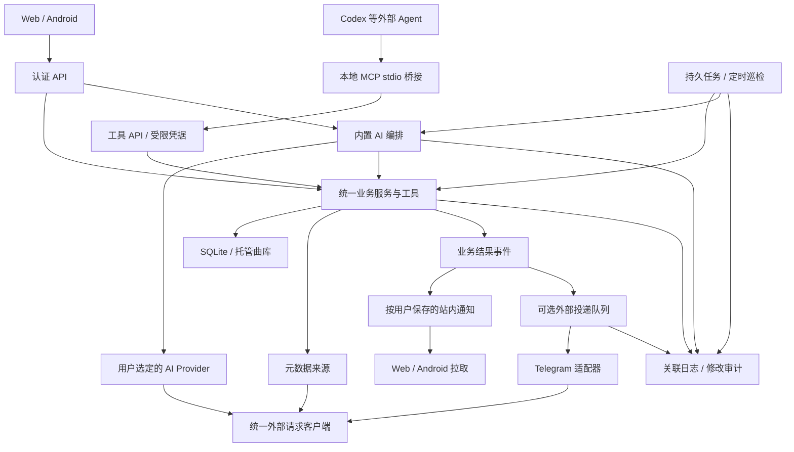

# AI 助手、MCP、诊断与通知开发计划

更新日期：2026-10-17。

状态：**用户已确认合并到 0.4.0，首版实现进入联合验收**。本文件保留开工时的阶段计划及验收清单，未逐项勾选不用于推断线上状态。当前代码、已执行验证与仍需真实账号／设备核对的边界见 [运行说明](../architecture/agent-platform.md) 与 [0.4.0 发布说明](../releases/v0.4.0.md)。

## 1. 已确认的方向

在现有 Python／FastAPI、React、Android 和 SQLite 基础上扩展，复用曲库、歌单、元数据来源、任务和权限。优先补齐网络请求与日志，再提供统一业务工具、通知和 MCP，最后扩展内置 AI 与持久巡检。

| 方向 | 本轮决定 |
| --- | --- |
| SIWC | 暂不实施 ChatGPT 订阅授权、OAuth、凭据刷新、执行器或相关 DevKit 集成，不作为其他阶段的依赖 |
| MCP | 让 Codex 等外部 Agent 使用真实曲库工具；基础操作不要求 WildString 配置模型 API |
| 内置 AI | 保留现有 API 模式，由用户选择连接、模型、功能和预算；支持交互式助手及后台巡检 |
| 修改方式 | 巡检先生成有依据的草案，用户确认后应用；共享曲库修改继续要求管理员权限 |
| 日志 | 支持程序查询、完整关联和脱敏，使网页、MCP、后台任务能够定位同一次失败 |
| 默认通知 | 服务端保存站内通知，Web 和 Android 登录、启动、回到前台或恢复联网后拉取；不要求实时推送 |
| Telegram | 首个可选外部通知渠道，用户主动配置并启用；不替代默认站内通知 |
| 工程形态 | 保持模块化单体与 SQLite，先使用现有进程内 worker；本轮不引入 Redis、Celery、ELK 或 LangGraph |

两种 AI 使用方式共用同一套业务能力：

- **Codex＋MCP**：外部 Agent 负责推理，WildString 负责权限、查询、草案和执行。普通查询、提交确定性任务、生成结构化草案不额外调用 WildString 模型。
- **内置 AI API**：WildString 使用用户选定的连接完成推理，调用同一套受控工具；需要模型推理的后台任务持续使用该连接，不能借用未连接的 Codex 会话。

本轮不增加自动标签写回、自动移动文件、任意 Shell／SQL 工具、跨设备远程播放控制、在线歌词聚合或 Telegram 对话指令。导入源保持只读，现有托管副本与数据库覆盖规则继续生效。见 [产品范围](scope.md)、[元数据整理](../architecture/metadata-repair.md) 和 [账号与访问](../../contracts/users-and-access.md)。

## 2. 当前基础与缺口

核查基线：本地 `fix/metadata-task-lifecycle`，HEAD `1aac1d0`，Python／Web 包版本 `0.3.4`；工作区还有元数据任务、离线与接续等未提交修改。后续开工须重新核对分支、schema 和 diff，保留既有工作；本表不能用于推断线上状态。

| 模块 | 静态核查结果 | 本轮需要补齐 |
| --- | --- | --- |
| [AI 配置](../../backend/src/wildstring/ai_config.py) | 实例级 `ai/.env`，模型测试使用 `http.client` | 与正式调用共用 Provider、网络策略和响应解析 |
| [推荐服务](../../backend/src/wildstring/recommendations.py) | 本地检索后最多发送 80 首候选，正式模型请求使用 `urllib` 并读取代理设置 | 解耦传输、模型与选歌业务，增加多轮工具调用 |
| [来源检测](../../backend/src/wildstring/provider_network.py)／[来源客户端](../../backend/src/wildstring/providers.py) | 已检测 MusicBrainz、Last.fm、CAA、AcoustID；正式来源请求另有重定向、大小与超时策略 | 统一客户端；区分服务响应、凭据可用和完整功能链路 |
| Web／Android | 已有 AI 找歌、候选预览、歌单保存；尚无多轮 Agent 页面 | 共用会话、草案、巡检及通知入口 |
| 用户与业务服务 | 已有管理员／普通用户、用户作用域 Repository、歌单版本和元数据历史 | 将散落在路由内的操作抽为公共服务，补充工具凭据和明确权限 |
| 后台任务 | 管理任务与来源任务已有持久状态；前者失活会标为中断，后者已有重排运行任务的逻辑 | Agent 任务的租约、阶段 checkpoint、取消、限额暂停与定时触发 |
| 日志与诊断 | 已有部分日志、Last.fm 回调脱敏和 Docker 日志轮转 | 请求与任务关联、结构化事件、受控检索；消除静默吞错及笼统失败 |
| 通知 | 已有 Last.fm 专用投递队列可借鉴；尚无通用站内通知、Telegram 通知 | 独立事件、用户收件箱、外部投递和订阅规则 |
| MCP | 仅有设计建议，尚无服务端或工具凭据 | 实际协议适配、工具、配置示例和 Codex 联调 |

现有设计可复用：[联网诊断](../architecture/provider-network-diagnostics.md)、[元数据任务生命周期](../architecture/metadata-task-lifecycle.md)、[客户端接续](../architecture/client-continuity.md)。其中的实现说明与本计划新增目标分别验收。

## 3. 整体架构与共同约束

以上是目标分工，不表示图中的模块已实现。纯规则巡检直接执行工具；只有选择 AI 分析的任务才经过模型。MCP 首版采用本地 stdio 桥接，通过 HTTPS 或明确配置的回环 HTTP 连接 WildString 工具 API，不直接读取远端数据库或音乐目录。直接提供远程 Streamable HTTP MCP 及相应授权发现作为后续扩展，不阻塞首版。

### 3.1 身份与权限

- 请求身份从服务端认证获取，不信任模型或客户端提交的 `user_id`、角色、凭据引用。
- 个人歌单、收藏、收听记录、会话、任务和通知均按实例、曲库和用户隔离。客户端本地缓存再按服务端地址及账号隔离。
- MCP 凭据单独创建、显示一次、摘要存储、可过期及撤销。权限是用户当前角色与授权 scope 的交集，角色变化、停用账号或撤销凭据后重新检查。
- 建议 scope 分为曲库读取、个人记录读取、草案创建、草案应用、任务提交／取消、诊断读取和通知读取。系统日志及全局诊断只向管理员授权开放。
- API 密钥／Bot Token 使用受保护的服务端秘密存储及不透明引用；普通响应只返回是否配置。MCP 不提供读取秘密或修改任意部署配置的工具。
- 个人模型地址受管理员端点策略约束；自托管局域网模型由管理员显式允许，不能把个人连接测试变成任意内网探测入口。

### 3.2 草案与修改

草案至少包含所有者、真实对象 ID、字段差异、来源证据、依据版本、创建时间和生命周期版本。歌单与共享元数据分别校验权限。查询执行成功、生成草案、用户批准、实际应用是不同结果。

应用使用幂等键及版本比较，修改、审计和结果事件在同一数据库事务中提交；文件／网络 I/O 不占用该事务。草案变化会使旧批准失效。首版在站内完成具体差异的批准；MCP 可以消费已批准草案执行并查询结果，不能仅提交模型生成的 `confirmed=true` 获得批准。重复应用返回原结果或明确冲突，不重复产生修改历史。

### 3.3 数据与兼容性

保留 `/api/v1/ai/discover`、现有歌单、元数据和任务接口的语义；新能力通过新增接口、可选字段和能力发现提供。旧客户端遇到新服务端仍可播放和找歌；新客户端遇到旧服务端显示功能不可用。

新表和字段使用连续、可重放验证的 SQLite 迁移；具体 schema 编号按开工时实际版本分配，不预占当前 schema 16 之后的版本。凭据、收件箱、业务结果、投递状态和诊断日志分开存储；高频诊断日志不逐条写入曲库事务。

## 4. 阶段总览与依赖

以下为开工时的阶段划分。0.4.0 首版已按此方向实现，联合验收及真实服务／设备验证分别记录；不能将本表直接视为已发布功能清单。

| 阶段 | 功能与交付物 | 前置依赖 | 验收门槛 |
| --- | --- | --- | --- |
| P0 | 基线、数据契约、权限和测试夹具 | 本计划 | 现有回归有记录；新旧状态与接口边界明确 |
| P1 | 统一 HTTP、依赖检测、日志与诊断 API | P0 | 测试与正式请求走相同路径；一次失败可关联定位 |
| P2 | 公共工具、草案、工具凭据、业务结果事件 | P0、P1 | 相同操作跨入口结果一致，越权和重复应用被阻止 |
| P3 | 默认站内通知及两端拉取；可选 Telegram | P1、P2 | 结果可在离线后补拉；Telegram 投递独立可追踪 |
| P4 | MCP 首版及 Codex 联调 | P1、P2；通知工具需 P3 | 无内置模型时，Codex 可查询、生成草案和诊断 |
| P5 | 持久巡检、调度、取消、恢复与预算 | P2、P3；MCP 入口复用 P4 | 重启、撤权、取消和部分失败不丢结果、不重复应用 |
| P6 | 用户可配置的内置 AI、多轮助手与 AI 巡检 | P1、P2、P5；共享工具经 P4 验证 | API 模型真实工具调用通过，关闭模型后基础能力可用 |
| P7 | 两端完整闭环、迁移、容器和发布验收 | P1–P6 | Web、Android、Codex 和通知共同完成端到端案例 |

推荐按 P0 → P1 → P2 实施；P3 和 P4 在公共契约稳定后可分别推进，P5、P6 再逐步增加自动化。每阶段都交付适用的 UI、测试及文档，P7 负责联合验收，不把所有客户端工作积压到最后。

## 5. P0：固定基线与数据契约

**功能与改动范围**

- 复核分支、工作区修改、部署入口、schema、现有 API 和旧客户端行为；本轮已有修改不自动归入后续功能提交。
- 固定工具执行上下文、草案、任务、日志和通知事件的字段、版本与错误码；补充未来 `contracts/` 文档，不在设计阶段伪造可用接口。
- 使用合成曲库构造同名歌曲、现场／录音室、多发行版、缺失封面／歌词、人工覆盖、失效来源和多用户夹具。
- 保留现有中文自然语言查询验收集；模型、代理、来源和 Telegram 均准备本地可控 HTTP 夹具。

**验收标准**

- [ ] 现有检查及相关回归有可重现的命令、基线结果和已知失败列表；历史失败与新回归分别记录。
- [ ] 所有权、角色／scope、草案确认、任务终态、通知已读和投递状态分别有明确契约。
- [ ] 迁移前后需要保留的曲目 ID、歌单、人工值、任务批次和秘密引用已列清单。
- [ ] 可在不访问真实账号、不修改个人曲库的环境运行上述夹具。

## 6. P1：统一网络与日志诊断

### 6.1 外部请求与依赖检测

把 `AIService.probe()`、推荐模型请求、元数据来源检测、来源业务请求及后续 Telegram 请求收敛到统一传输层。不同服务的请求体、重定向、超时、限流及解析规则由显式策略管理，检测复用实际服务客户端。

首批沿用现有 HTTP 代理／环境变量／直连能力，统一 `NO_PROXY` 与环境优先级；暂不以新增 SOCKS 等代理协议扩大范围。若后续 SDK 必须使用其他 HTTP 实现，应注入等价网络策略，并通过同一测试矩阵，不能让 SDK 私下自动选择另一套代理。

| 检测项 | 需要证明的能力 |
| --- | --- |
| MusicBrainz | API 可访问且返回有效公共实体 |
| Last.fm | API 及应用密钥可用；个人授权状态另列，检测不投递收听记录 |
| AcoustID | API 与客户端密钥可用；`fpcalc` 本机能力和实际识别分开检查 |
| CAA／封面下载 | 元数据 API 有效；通过已验证公共样本继续验证允许的图片跳转、受限下载和图片解码 |
| 当前 AI 连接 | 最小响应、合成候选的结构化选歌、后续工具调用分别显示验证结果 |
| Telegram（P3 接入） | Bot 身份／API 可用；目标投递通过显式测试消息另行验证 |
| Android 更新 | 复用客户端实际更新客户端验证 Release 查询与下载；不把服务端 GitHub 可达当作手机可下载的证明 |

检测状态区分可用、网络失败、凭据错误、授权失效、限流、响应异常、未配置、未验证。HTTP 401／429 说明远端有响应，但不代表功能可用；CAA 预期 404 只证明服务响应，不代表封面下载成功。展示检测时间、域名、耗时、HTTP 状态、脱敏的连接策略和验证范围。

测试可以使用代理／模型配置草稿，但测试不隐式保存；不回显密钥。来源检测目标由服务端维护；模型只能测试有权管理且符合端点策略的连接。失败时不自动切换付费连接或绕过用户选定的代理。

### 6.2 日志、审计与诊断

- 使用 Python 标准日志体系输出结构化 JSON；控制台与持久日志使用同一脱敏边界。开发文本展示可以保留，但字段语义一致。
- 公共字段包括 UTC 时间、schema 版本、级别、事件名、应用版本、实例／进程、`trace_id`、请求／任务／批次 ID、阶段、attempt、来源、耗时、HTTP 状态和稳定错误码。网页显示用户本地时间。
- 服务端生成或严格校验关联 ID；在线请求、工作线程、重启后的任务和工具调用显式传递上下文，避免并发串号。响应附诊断编号，Web／Android 错误页可复制。
- 记录任务入队、领取、心跳、阶段转换、取消、重试和恢复；外部调用记录目标域名与连接策略；AI 记录模型、工具名、校验结果和供应商实际返回的用量，不猜测 token 或费用。
- 修复后台静默吞错，保留安全异常类型、错误码与堆栈位置。DNS、代理、TLS 或响应阶段只有在证据支持时分类，其余为 `unknown`；代理链路无法证明的耗时不虚构拆分。
- 默认不记录密钥、Cookie、代理密码、完整 URL 查询串、Bot Token 所在路径、请求／响应正文、对话、歌词、音频、绝对音乐路径及堆栈局部变量。脱敏覆盖 Uvicorn、SDK 和异常链，不仅处理业务 logger。
- 日志按时间及容量轮转。建议默认保留 7 天、总上限 200 MiB；临时 DEBUG 最长 15 分钟，按模块／任务限定并自动恢复。这些是初始产品默认值，开发时在设置和契约中固定。
- 普通任务心跳和播放请求按规则汇总，重复错误限频并记录累计次数。日志写入失败有降级提示及有界缓冲，不拖慢播放、不无限占用内存。
- 修改审计复用业务历史并补操作来源、草案／批准及关联 ID，独立于诊断日志轮转。未处理草案和问题不因日志过期而删除。
- 提供固定参数的分页检索、单次操作时间线、任务诊断及脱敏诊断包；包中仅含版本、白名单配置摘要、任务快照和选定事件。服务端执行权限和输出大小限制，不接受任意路径、SQL 或 Shell。

**验收标准**

- [ ] 本地假代理与假服务证明：网页测试和真实 AI／来源请求使用相同代理解析、认证头、TLS／重定向策略及错误分类；不是只 mock 两个函数各自成功。
- [ ] 覆盖直连、环境代理、手动代理、`NO_PROXY`、代理认证、DNS／TLS／超时、401／407／429、5xx、异常响应及不允许的跳转；配置草稿不落库。
- [ ] CAA 接口成功、图片跳转失败能分别显示；结构化选歌失败不会因最小模型响应成功而显示全部可用。
- [ ] 两个并发用户及线程任务的关联 ID 不串号；任务重启后仍可查询之前的关联事件。
- [ ] 在 URL、异常、嵌套字段及堆栈中注入假密钥，控制台、文件、检索、下载包均无泄漏；跨用户日志查询被拒绝。
- [ ] 验证轮转、磁盘写入失败、有界队列、DEBUG 自动到期；日志故障不阻断合成音频播放。

## 7. P2：公共业务工具、草案与凭据

**功能与改动范围**

- 将查询、歌单操作、来源查询、元数据建议及应用从路由中抽为可复用服务。网页、MCP 和内置 AI 都传入认证后的执行上下文，共用校验和事务。
- 为工具定义结构化输入／输出、分页、数量和超时上限。返回音乐资料的最小投影，过滤服务器路径和秘密；标签、外部文本和模型输出均作为不可信数据。
- 提供歌单及元数据草案的创建、读取、修改、批准、应用和失效状态；来源 URL、外部 ID、字段差异和依据版本可追溯。
- 创建有所有者和 scope 的工具凭据；凭据权限不能超过用户角色，查询、应用和任务提交都重新鉴权。
- 定义带版本的业务结果事件，统一现有任务完成、部分失败、草案待确认及应用结果。事件与业务事务原子提交，供 P3 建立用户收件箱和外部投递记录。

**建议持久对象**

| 对象 | 关键内容 |
| --- | --- |
| 工具凭据 | 所有者、摘要、scope、有效期、撤销与授权版本 |
| 草案／批准 | 所有者、曲库／对象 ID、差异、证据、对象及草案版本、批准主体、应用幂等键 |
| 业务事件 | `event_id`、类型、schema 版本、用户／曲库、任务／草案／trace 引用、结果统计和发生时间 |
| AI 连接（P6 扩展） | 实例／个人归属、协议、端点、模型、秘密引用、权限、配置版本和能力验证结果 |
| Agent 任务（P5 扩展） | 所有者、授权来源、参数快照、状态、阶段、租约、checkpoint 和预算 |

**验收标准**

- [ ] 同一业务操作从网页服务适配与工具适配进入时，候选、版本冲突和权限结果一致。
- [ ] 普通用户可管理本人歌单，不能应用共享元数据；不能读取他人的历史、草案、连接或任务。
- [ ] 伪造 ID、跨曲库对象、过期版本、已撤销凭据及模型注入均不能扩大权限。
- [ ] 并发或重复应用只产生一次业务修改；数据库回滚不留下“修改成功”的事件。
- [ ] 差异变化后旧批准失效；导入源内容、托管原音和既有人工覆盖保持约定边界。

## 8. P3：默认站内通知与可选 Telegram

### 8.1 统一通知与站内收件箱

站内通知是默认渠道。服务端在事件落库后按用户建立唯一收件箱记录，Web 与 Android 展示同一份通知，不为每台设备重复生成结果。关闭 Telegram 或模型不影响站内通知。

标准通知包含事件类型、标题、摘要、严重程度、所有者、实例／曲库、任务／草案／trace 引用、统计、详情路由和发生时间。查询完成、草案生成、已应用、部分失败分别表达；不能把待确认草案称作已经修复。

| 事件 | 默认规则 |
| --- | --- |
| 用户主动提交的长任务完成 | 站内通知，包含成功／失败／跳过数量 |
| 巡检生成待确认草案 | 站内通知，附草案入口及未应用说明 |
| 失败／部分失败／需要处理 | 按批次汇总，附安全错误摘要和诊断编号 |
| 定时巡检无变化 | 默认静默，用户可选择接收 |
| 外部依赖持续异常／恢复 | 启用相应检查后按状态变化通知，合并重复异常 |

App 与网页在登录、启动、返回前台、恢复联网及手动刷新时拉取；持续前台可每 5 分钟补拉，作为可调整默认值。页面隐藏或 App 退出后不要求后台执行，不要求 FCM／APNs／厂商推送、Web Push 或操作系统通知权限；用户下次联网打开即可看到积压结果。

采用稳定排序、游标分页及服务端未读计数。各客户端独立保存同步位置，不能因手机拉取就让网页漏掉消息；已读／未读在账号级同步，读取列表本身不标已读。增量同步包含已读状态更新，或通过版本变化使客户端重新拉取。支持单条与快照范围内批量已读，批量操作不误读后来到达的消息。

通知与任务的执行、草案的批准、Telegram 的投递分别记录。普通通知建议保留 30 天；未处理待确认／失败提醒随对应业务状态保留，处理后再进入普通过期策略。游标过期须明确要求完整补拉，不能静默漏消息；客户端账户／服务器切换时清除或隔离旧缓存。

### 8.2 外部渠道与 Telegram

统一渠道接口负责配置校验、能力声明、消息渲染、发送和错误分类。首版实现 Telegram，后续邮件／Webhook 只扩展适配器，不把 Telegram 参数散落到业务任务中。

- 配置 Bot Token、Chat ID、可选 Topic、启用状态和代理策略。Token 保存于专用服务端秘密存储；URL 路径中的 Token 也必须脱敏。
- 用户按事件、严重程度及静默时段订阅；默认只启用站内通知。管理员管理系统告警／群组目标，个人结果只能路由到已验证且授权的目标。
- 接收目标启用前完成验证：可通过向该目标发送短效验证信息并在站内回填完成绑定，不能仅凭输入 Chat ID 获得他人的结果。测试／验证发送需用户在设置中显式触发。
- 使用确定性模板生成摘要，正确转义标题和外部文本，处理 Telegram 长度限制。超长结果归并为摘要和站内详情，不批量发送逐曲日志，也不调用模型润色。
- 详情链接使用管理员配置且校验过的服务地址，链接不含授权令牌，进入后仍需登录；未设置可用地址时只给任务编号，不生成指向 localhost 的链接。
- 首版仅出站通知及必要的目标验证，不提供 Telegram 指令、批准回调或机器人聊天；所有修改在站内确认。

### 8.3 持久投递与可观测性

建议分为业务事件、用户通知、渠道／目标／订阅和外部 deliveries 四类对象。沿用 SQLite 与短事务：业务结果、事件及待处理通知在同一事务形成可靠记录，网络发送由 worker 异步执行，不复用 Last.fm 的专用 outbox 表。

投递按“事件＋渠道＋目标”唯一约束，记录 `queued/sending/retry_wait/sent/failed/unknown/cancelled`、attempt、租约、下次尝试、错误码和 Telegram `message_id`。临时错误有界退避，限流遵守 `retry_after`；凭据／权限等永久错误停止重试，群迁移单独识别。

请求可能已到达 Telegram、但响应丢失时保留 `unknown`，提供人工核对和显式重试入口，不能承诺恰好一次投递。已拿到确认的消息不因重启再发。目标删除、账号停用、订阅关闭或授权版本变化后重新检查，避免向旧目标补发私人结果。

“已发送”仅代表 Telegram 接口确认接受，不代表用户已读。通知失败只影响投递状态，不把成功任务改为失败；站内仍显示原始结果和外部渠道失败信息，失败提示不递归向同一失败渠道发送。所有事件、收件箱和投递用任务 ID／`trace_id` 关联，供网页与 MCP 查询。

**验收标准**

- [ ] 不配置模型和 Telegram 时，Web／Android 均能在启动、回前台、恢复联网后补拉默认通知；退出期间不要求实时到达。
- [ ] 大批通知跨页无丢失／重复，两个设备独立补拉；单条／批量已读及其跨设备更新正确，列表读取不改变未读状态。
- [ ] 覆盖切换账号／服务器、游标失效、通知过期、未处理草案保留和旧服务端不支持接口的情况。
- [ ] 业务回滚无结果通知，事件重放不产生重复站内记录；部分失败和待确认状态准确。
- [ ] Telegram 测试区分 Bot 凭据验证、API 可达和目标实际投递，支持私聊、群组及 Topic；未验证目标不能接收个人结果。
- [ ] 模拟 429、5xx、401／403、超时结果不明、群迁移、服务重启、重复事件和目标撤销，验证退避、去重及状态记录。
- [ ] 模板转义、长度限制、详情链接、静默时段和脱敏通过；外部失败不阻断站内通知或任务。
- [ ] 真实 Bot／目标联调另记证据；没有真实凭据时只标自动化通过，不称 Telegram 已上线。

## 9. P4：MCP 首版与 Codex 操作

首版使用官方 MCP SDK 的标准协议实现，锁定与 Python 3.12、仓库许可证兼容的版本。Codex 启动本地 stdio 桥接，桥接使用受限凭据访问 WildString 工具 API；协议输出只走 stdout，日志走 stderr。凭据通过受保护配置／环境引用提供，不放启动命令参数或示例明文。

| 工具组 | 拟提供能力 | 权限和阶段 |
| --- | --- | --- |
| 曲库读取 | 搜索曲目、专辑、艺人；读取观测值／人工覆盖及本地歌词存在状态 | 真实 ID、分页及最小字段 |
| 个人资料 | 读取本人收藏、歌单、收听统计／历史 | 独立个人资料 scope |
| 检查与来源 | 查缺失字段、疑似冲突、来源候选及证据 | 本地规则只报告证据；联网遵守来源策略与限流 |
| 草案 | 创建／修改／查看歌单和元数据草案，应用已批准草案 | P2；应用仍需对象版本、scope 和业务权限 |
| 任务 | 提交、读取现有受控任务及结果；巡检、取消与恢复 | 新巡检能力需 P5，未实现时不能宣告可用 |
| 诊断 | `get_system_status`、`search_log_events`、`get_operation_trace`、`get_task_diagnostics`、`test_external_services` | P1；系统／全局日志需管理员 scope |
| 通知 | 查询本人收件箱与授权范围内的投递诊断 | P3；读取不标已读，不接收任意目标发送请求 |

工具使用输入／输出 schema、稳定错误码、只读／副作用注解和操作数量上限；注解只是描述，权限由服务端执行。提供能力发现、使用说明、脱敏资源和可复用检查提示；不以一个任意 API／SQL／Shell 入口代替业务工具。

首版应支持以下 Codex 工作流：

1. “找出许嵩的歌曲，检查缺失字段，查询有依据的专辑归属候选，生成草案。”
2. “从我很久没听的收藏中整理歌单，先给出候选，再按已批准草案保存。”
3. “查看刚才封面刷新任务的错误，区分来源查询、图片下载和保存失败。”
4. “查看巡检结果、默认站内通知和 Telegram 的投递状态。”

**验收标准**

- [ ] 用实际 MCP 客户端和 Codex 完成初始化、工具发现、分页查询、草案及错误返回，不只直接调用 Python 函数测试。
- [ ] WildString 无模型配置时，查询、确定性检查、草案和诊断均可用；工具执行不会隐式调用内置模型。
- [ ] 凭据撤销／降权即时阻止后续调用；跨用户与跨曲库访问、伪造批准、秘密读取及任意文件访问被拒绝。
- [ ] 工具描述与实际副作用一致；重复写操作受幂等约束，日志无协议污染或凭据泄漏。
- [ ] 交付本地和远端自托管实例的配置示例、权限说明、故障排查和 Make 入口；无需公网暴露数据库或新增无认证服务。

## 10. P5：持久巡检、调度与任务恢复

**功能与改动范围**

- 提供手动和定时巡检：缺失专辑／封面／歌词信息、本地关联异常、可通过外部来源验证的元数据冲突；先用本地规则筛选，再查询必要来源。歌词时间轴只有在规则可验证时报告疑似问题，不凭模型猜测音频内容。
- 记录任务所有者、触发入口、授权版本、参数及曲目版本快照、阶段、租约／心跳、checkpoint、计数和取消意图。执行状态、草案状态和通知状态保持独立。
- 状态至少覆盖排队、运行、重试等待、因授权／预算暂停、请求取消、已取消、成功、部分完成、失败及中断；每个状态的恢复操作写入契约。草案待确认不冒充仍在运行。
- 使用 SQLite 原子领取、唯一调度实例和租约超时防止重复工作；网络调用不持有数据库事务。重启后从已提交 checkpoint 继续，保留历史失败与尝试记录。
- 取消采用协作检查和外部调用超时，显示已完成部分与正在停止的步骤；不会把未结束调用立即标为取消成功。已提交结果保留，未执行部分不再启动。
- 定时任务保存时区、下次到期与去重键；错过周期默认合并为一次补跑，防止重启后集中补发。默认生成草案，不批准或应用修改。
- 限制单任务曲目数、并发、模型／来源调用数、时长及日预算；连接更换、撤权和账号停用在批次间重新检查，不能继续使用旧秘密。
- 对可能已经执行的写操作先查幂等结果；对响应丢失的模型请求记录未知／可能计费状态，避免重启后无界重复调用。
- 完成／部分失败／需要处理后发标准事件，默认站内可补拉；Telegram 按用户订阅投递。MCP 与网页查看同一任务和草案。

**验收标准**

- [ ] 合成整库巡检分批完成并给出真实来源、差异与数量，未确认前没有曲库写操作。
- [ ] 两个领取者竞争、进程中断、租约到期和重启不会重复应用或丢失已提交结果；部分结果与失败证据保留。
- [ ] 取消、预算耗尽、凭据撤销、对象版本变化和来源限流能进入明确可处理状态，不无限重试或伪装成功。
- [ ] 周期去重、时区、错过周期补跑和无人操作时的站内补拉通过；关闭订阅不删除已有业务结果。
- [ ] 关闭模型时规则巡检仍可完成；需模型的步骤明确暂停或跳过并说明范围。

## 11. P6：用户可配置的内置 AI

### 11.1 Provider 与连接

首版必须支持当前 Chat Completions 兼容 API；普通 API Key 的 Responses 适配可后续扩展，不成为 MCP 或首轮巡检的前提。SIWC 仍不实施。

P1 先保留实例级配置及旧接口，P6 再提供实例／个人连接的归属、选择、状态、测试、撤销和秘密管理。迁移保留现有连接与使用语义，明确展示共享范围；实例连接是否供其他用户使用由管理员配置。个人连接只归本人，任务开始时固定连接及配置版本，不静默切到其他人的连接或另一条付费路径。

用户可设置服务地址、协议、模型、超时、启用功能、后台使用授权和预算。结构化选歌与工具调用能力分别验证并标注检测时间，最小文本响应不等于 Agent 可用。模型名称、能力和预算不写死在业务逻辑中。

### 11.2 多轮助手与 AI 巡检

- 查询真实歌曲、多轮增删歌单候选、读取本人偏好与历史、解释元数据依据，并创建统一草案。
- 工具参数、模型返回 ID、来源证据和修改字段全部重新校验。上下文按需取数，不默认上传整库、路径、歌词或音频；模型缺少依据时提出歧义或返回不确定。
- Pydantic AI 作为优先验证的框架候选；通过当前兼容 API 的工具调用、结构化输出、代理注入和中断测试后再锁定依赖。框架不接管业务权限或代替任务持久化。
- 会话、消息、运行与草案按用户隔离，可删除历史并配置保留策略；默认日志只记录摘要，不复制对话。长任务状态留在服务端，Web／Android 断连后重新读取。
- 明确区分普通聊天和启动后台巡检。定时 AI 使用需用户授权，并受任务预算与当前连接权限约束。
- 内置模型不可用时保留现有本地找歌回退，说明降级；播放、曲库浏览、MCP 和规则巡检继续可用。Agent 不能把本地回退当成模型完成了复杂分析。

**验收标准**

- [ ] 已保存实例连接和旧 `/ai/discover` 行为兼容；个人连接、共享实例连接及关闭 AI 的状态明确。
- [ ] 至少复用 30 条中文检索验收，覆盖繁体、同名、现场／发行版、歧义和空曲库；零虚构 ID，不能凭模型编造听感依据。
- [ ] 两个用户并发对话／任务、切换连接、撤销和服务重启不串凭据、上下文或预算；无全局环境变量切换用户秘密。
- [ ] 模型请求失败、无工具能力、非法工具／参数、超出调用预算、响应格式错误及恶意标签有明确结果，不绕过校验。
- [ ] 真实 API 联调记录协议、模型、工具能力和脱敏请求结果；只有夹具通过时标明真实服务尚未验证。

## 12. P7：两端闭环与交付验收

各阶段分别提供可用页面；本阶段集中验证完整用户流程及旧版本兼容。

| 入口 | 交付内容 |
| --- | --- |
| Web | 模型连接及能力检测、外部依赖状态、日志筛选与诊断编号、任务／草案、默认通知中心和未读数、Telegram 配置与投递记录、多轮助手 |
| Android | 共用模型／会话／任务 API，查看和确认草案、任务恢复、默认通知中心／未读／补拉、诊断编号；保持服务器及账号隔离，后台结果在下次前台读取 |
| Codex | MCP 配置、范围清晰的工具说明、业务检查／修复草案、日志与通知诊断示例 |
| 运维 | 日志容量及保留、受限凭据撤销、通知重试／未知状态处理、数据库备份恢复、客户端兼容和回滚说明 |

**整体验收场景**

- [ ] Codex 在无内置模型情况下查询曲库，核对来源并生成草案；管理员在站内确认后应用一次，日志和审计能定位完整过程。
- [ ] 内置 AI 使用用户 API 完成多轮歌单调整；保存结果与普通歌单一致，模型失败时不影响正在播放的歌曲。
- [ ] 定时巡检中途重启并出现部分来源失败，恢复后统计准确，草案未自动应用；手机和网页离线后重新打开均补拉到结果。
- [ ] 一端已读、另一端补拉能同步；切换用户或服务端不会显示旧收件箱、任务或会话。
- [ ] Telegram 未配置时默认通知完整可用；配置后的投递、退避、未知结果和失败可由网页／MCP 查询，失败不改变任务结果。
- [ ] 从网页错误编号或 Telegram 的诊断编号，经受控日志查询定位到具体步骤，保留已验证事实与未知项。
- [ ] 旧 Web／Android 的找歌、浏览、Range／AAC、收藏、歌单、离线与跨设备接续无回归；新客户端能处理旧服务端缺少新接口。
- [ ] 迁移前后曲目 ID、用户数据、人工覆盖、任务批次和秘密引用一致；迁移失败原子回滚。应用降级需要兼容 schema 或恢复备份，不直接让旧镜像写新库。

## 13. 模块与接口改动范围

下表是建议组织方式，目录／路由名在 P0 固定契约后再落地；不存在的路径只作计划，不作为已发布 API。

| 范围 | 现有入口 | 计划改动 |
| --- | --- | --- |
| 传输与模型 | `ai_config.py`、`recommendations.py`、`providers.py`、`provider_network.py` | 公共 outbound 客户端、来源策略及 AI Provider；迁移旧测试和请求 |
| 日志与诊断 | `main.py`、`__main__.py`、`request_privacy.py`、worker、`deploy/` | 公共日志／上下文／脱敏模块、查询与诊断包，覆盖本地及 Docker 入口 |
| 工具与草案 | `auth.py`、`library/`、`management.py`、来源路由 | 公共业务服务、工具上下文、凭据、草案批准与幂等应用 |
| 数据和任务 | `database.py`、现有任务 schema／worker | 增量迁移、事件、Agent 任务、lease／checkpoint／scheduler，保留旧任务语义 |
| 通知 | 当前无通用模块 | 站内收件箱、偏好／目标、渠道适配、Telegram outbox 及投递诊断 |
| MCP | 当前无实现 | SDK 桥接及工具 API；资源／工具能力发现和连接示例 |
| 内置 Agent | 当前仅推荐选歌 | 会话、受控工具循环、用户连接、预算和任务执行适配 |
| 客户端 | `frontend/web/src/`、`frontend/android/app/` | 逐阶段增加设置、草案／任务、诊断、收件箱及前台拉取 |
| 工程与文档 | `Makefile`、锁文件、`contracts/`、`docs/` | 按阶段增加测试入口、协议文档、运维说明和真实联调记录 |

拟新增接口族包括连接、工具凭据、草案、Agent 会话／任务／计划、诊断、本人通知／已读、渠道配置／测试和投递记录。读取与写操作分开；通知拉取使用普通已认证 HTTP，不依赖 SSE／WebSocket。会话流式输出可独立评估，不影响任务或通知的补拉语义。

## 14. 验证、迁移与发布纪律

- Python 3.12 与 `backend/uv.lock`、Node 22 与 `package-lock.json` 保持统一。新增 SDK 先核对许可证、Python 版本与网络策略；修改依赖同步更新锁，Android 依赖按原有锁及验证元数据流程处理。
- 复用现有 Ruff、Bandit、pre-commit 与测试框架，新增开发入口统一放入 Makefile；不额外维护独立 hook 版本。
- 代码阶段完成 `make ci`；Android 变更完成 `make android-ci android-connected-test`；运行／部署变更完成 `make docker-up docker-smoke`，必要时 `make docker-test`。新范围专项测试加入相应入口。
- 自动化使用合成资料、假秘密和模拟外部服务。真实模型、Telegram、来源和 Codex 联调另记版本、时间、操作步骤、结果、关联 ID 与未验证部分，不把模拟成功当作真实账号成功。
- 数据库升级先在副本演练并保留可恢复备份，验证 WAL／SHM 处理、曲库与秘密引用；停止命令保留持久卷。功能开关默认保守，新 Agent／计划任务／Telegram 需显式启用，站内通知默认提供。
- 提交前只选本批路径，检查 diff、秘密与大文件，保留工作区其他修改。合并、版本发布、下载产物验证和实际部署分别记录，不因文档完成或 CI 通过而宣称上线。
- 每个阶段交付记录至少列出：改动与依赖、迁移／回滚、自动化结果、真实联调结果、限制、未完成验收及发布状态。

## 15. 暂缓项与参考

SIWC、ChatGPT 订阅额度集成、OAuth 凭据与独立个人执行器均不在本轮范围。未来若重新讨论，应单独核查官方授权、额度、运行环境和许可证，不在当前连接模型中存放未使用的订阅凭据。

远程直接 HTTP MCP、额外通知渠道、系统推送、无人值守应用修改、标签写回、任意文件整理和复杂 Agent 框架均后置；站内拉取式通知和 Telegram 已足以完成当前结果通知目标。

参考资料用于核对接口与协议，不代表已接入或真实联调通过；实施时重新核对适配版本：

- [MoviePilot 网络检测实现](https://github.com/jxxghp/MoviePilot/blob/v2/app/api/endpoints/system.py)：借鉴服务端维护目标、逐项策略和内容校验；WildString 使用自己的依赖清单。
- [MCP 传输规范](https://modelcontextprotocol.io/specification/2025-11-25/basic/transports)、[工具规范](https://modelcontextprotocol.io/specification/2025-11-25/server/tools)：首版 stdio 与工具契约的参考。
- [Codex MCP 配置](https://learn.chatgpt.com/docs/extend/mcp?surface=cli)：外部 Agent 接入与联调参考。
- [Pydantic AI 工具](https://pydantic.dev/docs/ai/tools-toolsets/tools/)：内置 Agent 候选框架的工具／上下文机制，具体模型兼容性仍需验证。
- [Telegram sendMessage](https://core.telegram.org/bots/api#sendmessage)、[ResponseParameters](https://core.telegram.org/bots/api#responseparameters)：目标、Topic、消息结果、群迁移和限流重试参数。

本计划取代 [早期 Agent 决策](../decisions/0002-ai-connections-and-agent.md) 中尚待核对的实施顺序；现有业务契约继续生效，新增功能的实现与验证按各阶段交付记录更新。
