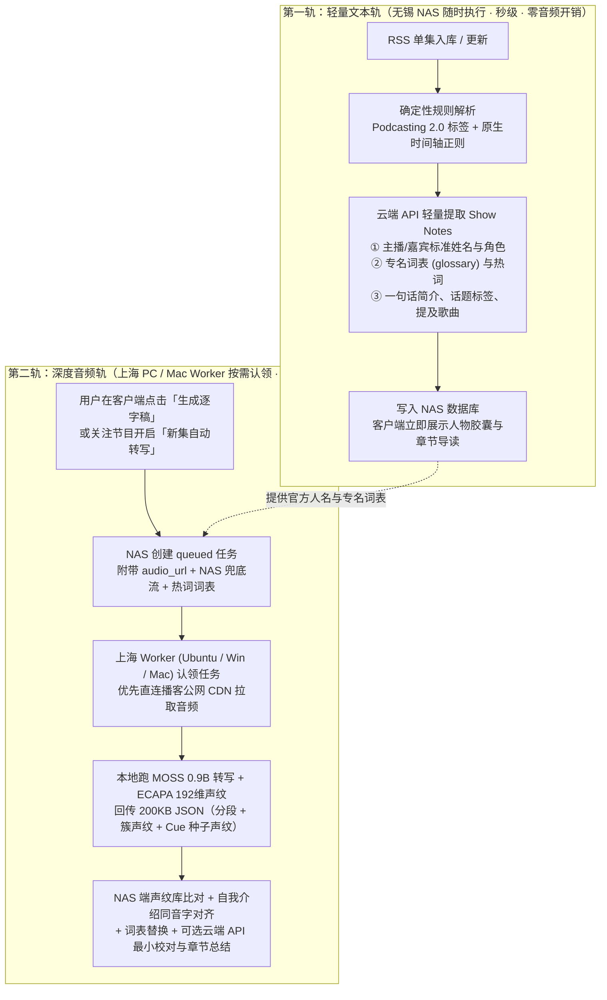
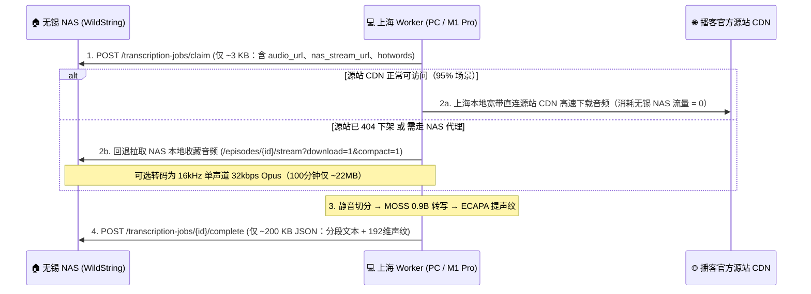

# 播客人物识别、声纹归档与异地逐字稿转写方案

更新日期：2026-11-07
状态：**设计方案草案（尚未在 WildString 主仓库实现）**。音频转写与声纹原型已在本地 `MOSS-Transcribe-Diarize/runs/podcast-pipeline/` 完成《声东击西》#406、#407 实测验证。

---

## 1. 背景与核心约束

### 1.1 真实物理拓扑与硬件条件
- **服务端（无锡 NAS）**：7×24 小时常驻运行 WildString，CPU 与内存配置较弱，无独立 GPU；家庭宽带上行带宽有限。
- **算力端（上海个人电脑）**：间歇性开机，与无锡 NAS 异地连接，包含：
  - `company-pc`（Ubuntu 24.04，RTX 5060 Laptop 8 GB VRAM，32 GB RAM）
  - 开发机（macOS，Apple M1 Pro 16 GB 统一内存）
  - 潜在 Windows CUDA 台式机/笔记本
- **消费端（多端客户端）**：Web、Android（如骁龙 8 Gen 3 手机）、iOS、macOS 原生客户端。

### 1.2 前期原型实验关键结论（#406 / #407 实测）
基于本地 `MOSS-Transcribe-Diarize` 原型实验，已确认以下事实边界：
1. **转写与分段分离能力**：`MOSS-Transcribe-Diarize 0.9B`（BF16 + SDPA）配合静音切分（`plan_chunks.py`），在 RTX 5060 8 GB 上处理 100 分钟播客耗时约 464 秒（12.9× 实时），显存峰值 3.7～5.0 GB，时间轴覆盖率 97.4%～98.8%。
2. **跨段与跨期身份一致性必须靠声纹**：MOSS 输出的 `[S01]`、`[S02]` 仅在单一切片内有效，跨段会漂移。引入 `speechbrain/spkrec-ecapa-voxceleb`（约 80 MB，输出 192 维向量）提取（切片, 局部说话人）声纹质心后，同一人跨段/跨期余弦相似度稳定在 `0.78～0.94`（阈值 `0.6`）。
3. **Cue 单句声纹播种自动命名**：从转写文本匹配自我介绍（`我是X`、`我叫X`）与主持人介绍（`这位是X` → 绑定 60 秒内下一位开口说话人），**直接截取该句音频提取声纹种子**（避免局部簇混入多人污染质心），再按余弦阈值 `>= 0.6` 传播到全集，在 #407 上实现 **35/35 说话人簇 100% 自动命名一致**。
4. **声纹管「是不是同一个人」，词表管「名字和专名怎么写」**：语音自报姓名常出现同音异字（如 `吴承汉→吴承瀚`、`雅贤→雅娴`）及专业术语误写（如 `脑神部→脑深部`、`光一传→光遗传`）。必须先从单集 Show Notes 提取官方人名与专名词表（`glossary`），作为热词提示与确定性替换基准。
5. **拿掉本地 7B/8B LLM，文字脑力活交由云端 API**：
   - 本地 7B/8B（约 5～6 GB）与 MOSS（5 GB）无法同时驻留 8 GB 显存，且小模型在逐句校对中易发生删减实词、改写语序或截断；
   - 砍掉本地 LLM 后，本地算力节点只需常驻 **MOSS 0.9B + ECAPA（合计 3～4 GB）**，Show Notes 词表提取、疑难专名最小编辑（`edits`）及全文摘要/章节生成统一交由 NAS 已配置的云端大模型 API 处理。

### 1.3 客户端端侧运行可行性评估结论
| 运行目标 | 硬件规格 | 评估结论 | 原因说明 |
| :--- | :--- | :--- | :--- |
| **Ubuntu / Windows PC** | NVIDIA GPU (>= 6 GB VRAM) | **主力推荐** | PyTorch CUDA + BF16/FP16 + SDPA 原生支持，100 分钟播客约 7～11 分钟跑完。 |
| **Apple Silicon Mac** | M1 Pro (16 GB 统一内存) | **完全可行（伴侣 Worker）** | 去掉本地 7B 后，MOSS FP16（1.8 GB 权重）+ ECAPA（80 MB）在 240～300 秒切片下峰值内存约 2.8～3.5 GB；通过 PyTorch `mps` 后端即可直接运行（约 4×～6× 实时，60 分钟播客约 10～15 分钟）。作为本机后台 Python Worker 运行，不打包进轻量 Swift 客户端包体。 |
| **Android 手机** | 骁龙 8 Gen 3 (12/16 GB) | **不建议塞入 App** | 1. **工程阻碍**：MOSS 为 `WhisperEncoder + 4x time_merge + VQAdaptor + masked_scatter + Qwen3` 自定义拼接图，外加 SpeechBrain ECAPA，缺乏现成移动端 C++/GGUF/ONNX 推理管线；INT4 量化易损坏时间戳与 `[Sxx]` 标签。<br/>2. **发热与掉电**：单集长播客需连续解码 3 万+ Token、满载运行 20 分钟以上，必触发手机温控降频、单集掉电 15%～25%，且切后台极易被 Android LMKD/PhantomProcess 杀进程。 |

---

## 2. 总体架构：双轨识别 + 异地零带宽压力协同

### 2.1 双轨识别机制（保证 PC 未开机时也有完整基础体验）



### 2.2 无锡 NAS ↔ 上海电脑 ↔ 手机的音频流与收藏设计

为了解决**「无锡 NAS 异地上行带宽小」**与**「重要播客需要在 NAS 本地永久收藏防下架」**的双重需求，播放、收藏与转写采用以下双通道策略：

#### 1. 手机/网页日常播放与 NAS 收藏（完全保留现有能力并优化）
- **NAS 本地收藏优先**：
  - 用户对单集点击「保存到服务器」（`POST /api/v1/podcasts/episodes/{id}/download`）或对节目配置自动下载保留（`keep`）后，音频持久保存在无锡 NAS 硬盘并建立个人引用（`resource_saved = true`），**零引用自动清理绝不删除手动收藏单集**。
  - 播放时（`GET /api/v1/podcasts/episodes/{id}/stream`），只要 NAS 硬盘已有该音频，直接从无锡 NAS 串流（即使源站全网删稿仍可播放）。
- **未收藏单集的公网直连与代理兜底**：
  - 未在 NAS 收藏的普通单集，客户端可优先尝试直连播客源站公开 CDN（`audio_url`），秒开且不占无锡 NAS 上行带宽；若源站跨域受限或为需代理的海外源，则无缝走 NAS `stream?proxy=1` 代理串流。

#### 2. 上海 Worker 获取音频的双源回退（零占无锡带宽 + 收藏兜底）


---

## 3. 核心算法与业务流水线拆分

将原型验证过的流水线按 **「重算力（上海 Worker）」** 与 **「轻逻辑/状态管理（无锡 NAS）」** 拆解：

### 3.1 第一步：NAS 端 Show Notes 预解析（入库时或转写前）
1. **确定性提取**：
   - 解析 RSS `<podcast:person>`、`<podcast:chapters>`、`<podcast:transcript>`；
   - 正则提取 Show Notes 中的时间戳行（如 `02:15 为什么...`）与书名号实体（`《...》`）。
2. **云端 API 结构化提取（JSON Schema）**：
   - 输入：节目名称、常驻主播、单集标题、Show Notes 纯文本。
   - 输出：
     ```json
     {
       "people": [
         {"name": "徐涛", "role": "host", "aliases": []},
         {"name": "吴承瀚", "role": "guest", "aliases": [], "bio": "斯坦福大学博士后"},
         {"name": "雅娴", "role": "cohost", "aliases": []}
       ],
       "glossary": {
         "卡尔·戴瑟罗斯": "Karl Deisseroth",
         "光遗传学": "光遗传学",
         "照亮破碎之心": "《照亮破碎之心》"
       },
       "hotwords": ["徐涛", "吴承瀚", "雅娴", "声东击西", "Karl Deisseroth", "光遗传学"],
       "summary": "本期探讨光遗传学与脑深部电刺激在精神疾病治疗中的突破...",
       "topics": ["神经科学", "脑机接口", "抑郁症"],
       "mentioned_music": []
     }
     ```

### 3.2 第二步：上海 Worker 端音频推理（无状态纯 Python CLI）
Worker 接收音频与 `hotwords` 后，在本地依次执行：
1. **静音切分（`plan_chunks`）**：
   - 使用 `ffmpeg silencedetect`（`-32dB`, `0.5s`）在停顿处切分，重叠区 `overlap = 15s`。
   - **切片时长自适应**：CUDA 默认目标 `540s`（9 分钟）；macOS `mps` 默认目标 `270s`（4.5 分钟），动态计算 `max_new_tokens = min(32768, ceil(dur * 14) + 512)`。
2. **MOSS 0.9B 逐段转写与接缝去重**：
   - 将 `hotwords` 拼入默认提示词尾部（`热词提示：...`）。
   - 相邻切片在重叠区中点切分，并对边界处满足「时间重叠 + 文本包含/高相似度」的碎片去重。
3. **ECAPA 声纹提取（两类向量）**：
   - **簇质心向量（`cluster_embeddings`）**：对每个 `(chunk_index, local_speaker)` 筛选时长 `>= 0.7s` 的最长前 12 个片段，按时长加权平均并 L2 归一化，得到 192 维向量。
   - **Cue 单句种子向量（`cue_seeds`）**：用正则扫描转写文本中的自我介绍（`我是X`、`我叫X`）与他介（`这位是X` → 60 秒内下一位不同说话人），**仅截取触发线索的那一句音频**提取独立的 192 维声纹向量，防止局部簇混入他人声音污染种子。

### 3.3 第三步：NAS 端声纹归档、同音字回正与后处理
NAS 收到 Worker 回传的 JSON 后，在毫秒级内完成拼装：
1. **跨期已知人物声纹匹配（`registry`）**：
   - 将每个簇的 192 维向量与 NAS `podcast_people` 表中已保存的声纹向量计算余弦点积（`np.dot`）。
   - 若某主播/常驻嘉宾（如徐涛）在往期已注册声纹，且余弦得分 `>= 0.75`，直接命中绑定。
2. **新人物 Cue 播种与「Show Notes 同音字回正」**：
   - 对 Worker 提取出的 `cue_seeds`（如 ASR 文本写为 `"吴承汉"`、`"雅贤"`），与第一步从 Show Notes 提取的官方人物名单（`["徐涛", "吴承瀚", "雅娴"]`）进行**拼音/编辑距离比对**；
   - 拼音一致或高相似时，自动将姓名修正为 Show Notes 的标准汉字写法（`"吴承瀚"`、`"雅娴"`），并用该种子向量按余弦 `>= 0.60` 传播至全集其余切片。
   - 低于 `0.60` 的簇标记为 `unknown`（未知说话人），保留其 `chunk:Sxx` 标识供前端一键认领。
3. **确定性词表替换 + 可选云端 API 最小编辑（`edits`）**：
   - 先执行确定性 `glossary` 替换、被修正人名的全文替换，以及确定性口吃去重（如连续叠词 `趁着趁着→趁着`、`在在→在`）。
   - 若开启「云端 API 语义精校」，分批调用 NAS 配置的 API 大模型，仅允许返回 `{id, edits: [{old, new}]}` 最小替换对，并保留安全护栏（受保护词表禁止改写、禁止句末续写、禁止删除连词/否定词、数字必须一致）。
   - 生成的修改记录保存 `before / after / stage`（`glossary` 或 `llm`），被拦截的修改存入 `rejected_edits` 供核对页查看。

---

## 4. 跨平台 Worker 适配方案（Ubuntu / Windows / macOS）

在 `MOSS-Transcribe-Diarize` 中封装统一的 `mtd-worker` 命令行入口，消除平台差异：

1. **计算设备与精度自动选择**：
   ```python
   def resolve_worker_runtime(preferred_device: str = "auto"):
       if preferred_device == "auto":
           if torch.cuda.is_available():
               return torch.device("cuda:0"), torch.bfloat16, 540.0
           if hasattr(torch.backends, "mps") and torch.backends.mps.is_available():
               return torch.device("mps"), torch.float16, 270.0
           return torch.device("cpu"), torch.float32, 180.0
   ```
2. **三大平台兼容细节**：
   - **Ubuntu (`company-pc`)**：使用 `cuda:0` + `bfloat16` + `sdpa`（或 `flash_attention_2`），切片 540 秒。
   - **macOS (`M1 Pro 16GB`)**：使用 `mps` + `float16` + `sdpa`，切片自动缩至 270 秒，每个切片推理后调用 `torch.mps.empty_cache()` 保持统一内存平稳。
   - **Windows (`CUDA`)**：
     - 废除 `.sh` 脚本，全部逻辑（静音切分、逐段推理、声纹提取、HTTP 上报）收拢到纯 Python 进程，文件路径统一使用 `pathlib.Path` 与 `encoding="utf-8"`；
     - `SpeechBrain` 加载 `spkrec-ecapa-voxceleb` 时显式传入 `local_strategy=LocalStrategy.COPY`，避免 Windows 非管理员权限下创建 symlink 报错。
3. **运行模式**：
   - **守护轮询模式**：`mtd-worker --server https://nas.example.com --token <worker_token> --poll-interval 30`（开机后台静默运行，有任务自动认领，无任务零占显存）。
   - **单次清空模式**：`mtd-worker --server ... --once`（跑完当前队列即退出并释放显存）。

---

## 5. 数据库表结构与 API 契约设计（NAS 服务端）

### 5.1 新增数据库表（SQLite）

#### 1. `podcast_people`（跨节目播客人物与声纹库）
| 字段 | 类型 | 说明 |
| :--- | :--- | :--- |
| `id` | `TEXT PRIMARY KEY` | 人物唯一 ID |
| `name` | `TEXT NOT NULL` | 标准展示名（如 `徐涛`、`吴承瀚`） |
| `aliases_json` | `TEXT NOT NULL DEFAULT '[]'` | 别名/英文名/常见 ASR 同音错字（如 `["吴承汉"]`） |
| `bio` | `TEXT NOT NULL DEFAULT ''` | 人物简介 |
| `avatar_url` | `TEXT NOT NULL DEFAULT ''` | 头像地址（可选） |
| `voiceprint_json` | `TEXT` | 192 维 L2 归一化 ECAPA 声纹质心向量 JSON |
| `voiceprint_samples` | `INTEGER NOT NULL DEFAULT 0` | 已累积声纹样本数（支持跨期滑动平均更新） |
| `source` | `TEXT NOT NULL DEFAULT 'ai'` | `rss` / `ai` / `manual`（人工确认后重跑不覆盖） |
| `version` | `INTEGER NOT NULL DEFAULT 1` | 乐观锁版本号 |
| `created_at` / `updated_at` | `TEXT NOT NULL` | ISO 时间戳 |

#### 2. `podcast_episode_people`（单集出场人物关联）
| 字段 | 类型 | 说明 |
| :--- | :--- | :--- |
| `episode_id` | `TEXT NOT NULL` | 关联 `podcast_episodes.id` |
| `person_id` | `TEXT NOT NULL` | 关联 `podcast_people.id` |
| `role` | `TEXT NOT NULL` | `host`（主播）/ `cohost`（常驻）/ `guest`（嘉宾）/ `mentioned`（提及） |
| `segment_count` | `INTEGER NOT NULL DEFAULT 0` | 发言段数（仅文本识别时为 0） |
| `talk_duration_sec` | `REAL NOT NULL DEFAULT 0` | 发言总时长（秒） |
| `confidence` | `REAL NOT NULL DEFAULT 1.0` | 匹配得分（声纹余弦值或规则置信度） |
| `source` | `TEXT NOT NULL` | `rss` / `show_notes` / `cue` / `voiceprint` / `manual` |

#### 3. `podcast_episode_insights`（单集内容导读、词表与逐字稿元数据）
| 字段 | 类型 | 说明 |
| :--- | :--- | :--- |
| `episode_id` | `TEXT PRIMARY KEY` | 关联 `podcast_episodes.id` |
| `summary` | `TEXT NOT NULL DEFAULT ''` | 单集核心看点摘要 |
| `topics_json` | `TEXT NOT NULL DEFAULT '[]'` | 话题标签列表 |
| `chapters_json` | `TEXT NOT NULL DEFAULT '[]'` | 章节时间轴 `[{start_sec, title, summary, source}]` |
| `glossary_json` | `TEXT NOT NULL DEFAULT '{}'` | 本期专名词表与热词 |
| `mentioned_tracks_json` | `TEXT NOT NULL DEFAULT '[]'` | 提及的本服真实音乐 `track_id` 及时间点 |
| `transcript_status` | `TEXT NOT NULL DEFAULT 'none'` | `none` / `queued` / `running` / `completed` / `failed` |
| `transcript_path` | `TEXT` | 托管目录下结构化逐字稿 JSON 文件路径（含分段、修改记录、未分配簇声纹） |
| `updated_at` | `TEXT NOT NULL` | 更新时间 |

#### 4. `podcast_transcription_jobs`（异地 Worker 转写任务表）
| 字段 | 类型 | 说明 |
| :--- | :--- | :--- |
| `id` | `TEXT PRIMARY KEY` | 任务 ID |
| `episode_id` | `TEXT NOT NULL UNIQUE` | 目标单集 ID |
| `status` | `TEXT NOT NULL` | `queued` / `running` / `completed` / `failed` / `cancelled` |
| `worker_name` | `TEXT` | 认领任务的节点名（如 `company-pc`、`macbook-m1pro`） |
| `progress_chunk` | `INTEGER DEFAULT 0` | 当前已完成切片数 |
| `total_chunks` | `INTEGER DEFAULT 0` | 总切片数 |
| `error_detail` | `TEXT` | 失败原因 |
| `lease_expires_at` | `TEXT` | 租约过期时间（Worker 断线超时后自动回到 `queued`） |
| `created_at` / `updated_at` | `TEXT NOT NULL` | 时间戳 |

### 5.2 核心 API 契约

1. **Worker 专用接口（使用独立受限的 Worker Token 鉴权，不复用浏览器会话）**：
   - `POST /api/v1/podcasts/transcription-jobs/claim`：认领一个 `queued` 任务，返回 `episode_id`、`source_audio_url`（公网 CDN）、`nas_audio_url`（NAS 兜底下载流）、`hotwords` 与建议切片参数。
   - `POST /api/v1/podcasts/transcription-jobs/{job_id}/progress`：续期租约并上报 `{chunk, total_chunks, elapsed_sec}`。
   - `POST /api/v1/podcasts/transcription-jobs/{job_id}/complete`：上传 `{segments, cluster_embeddings, cue_seeds, metrics}`，触发 NAS 端声纹匹配、词表替换与入库。
2. **客户端消费与核对接口（遵守 `podcast_access.py` 个人可见性隔离）**：
   - `GET /api/v1/podcasts/episodes/{episode_id}/insights`：获取单集人物、章节、摘要、逐字稿及校对差异。
   - `POST /api/v1/podcasts/episodes/{episode_id}/transcribe`：将该单集加入转写队列。
   - `PUT /api/v1/podcasts/episodes/{episode_id}/speaker-clusters`：将某未知说话人簇（如 `3:S02`）手动绑定到某人物，并可选将其向量并入 `podcast_people` 声纹库。
   - `GET /api/v1/podcasts/people` & `GET /api/v1/podcasts/people/{person_id}`：浏览人物列表及某位主播/嘉宾跨节目参与的所有单集（「串台追踪」）。

---

## 6. 客户端与 AI 助手体验设计（吸收 `demo-407.html` 原型）

1. **单集详情页增强（Web / Android / iOS / macOS）**：
   - **出场人物栏**：展示 `主播 · 徐涛`、`嘉宾 · 吴承瀚` 等胶囊，附带发言占比；点击人物胶囊可筛选只看 TA 的发言，或进入该人物的跨节目档案页。
   - **章节导读与音乐卡片**：展示 Show Notes 或转写提炼的章节时间轴，点击直接跳转播放进度；若本期提及了本服曲库中的歌曲，直接展示可一键播放/加歌单的曲目卡片。
   - **交互式逐字稿面板（复刻并升级 `demo-407.html`）**：
     - 播放时自动高亮当前 `[start, end]` 段落并平滑跟随，点击任意段落直接 Seek；
     - 支持关键词搜索、按说话人过滤 Chips、`词表 / AI校对` 徽章展示及「显示校对前原文」开关；
     - 网页端提供轻量复核入口：对 `未知` 说话人点一下即可指定名字并注册声纹；对拦截的可疑修改可一键采纳或退回。
2. **AI 助手与 MCP 工具联动**：
   - 新增受控工具 `search_podcast_by_person_or_topic`、`get_podcast_episode_transcript`：
   - 支持自然语言指令，例如：*“找一下吴承瀚做客的那期播客”*、*“把《声东击西》第 407 期里聊到脑机接口的那几段找出来”*。

---

## 7. 分阶段落地路线图

- **阶段一：数据底座与已有实验成果直接上屏（最小闭环）**
  - 新增 `podcast_people`、`podcast_episode_people`、`podcast_episode_insights` 表与查询 API；
  - 支持直接导入你在 `MOSS-Transcribe-Diarize/runs/podcast-pipeline/` 已经跑好的 #406、#407 产物；
  - 在 Web 单集详情页上线「人物胶囊 + 按说话人筛选 + 逐句跟随跳转 + 原文/校对对比」。
- **阶段二：Show Notes 第一轨自动提取 + 跨节目人物串台页**
  - 接入 RSS 入库/刷新时的 Show Notes 规则与云端 API 提取，自动生成单集人物、章节与 `glossary` 词表；
  - 上线「播客人物」聚合页与声纹手动认领/合并功能。
- **阶段三：三端通用 `mtd-worker` 与异地队列打通**
  - 完成 `MOSS-Transcribe-Diarize` 的 `mps`（M1 Pro）与 Windows 兼容改造，封装 `mtd-worker`；
  - 打通「上海电脑从公网 CDN 拉音频（NAS 收藏兜底）→ 本地跑 MOSS+ECAPA → 回传无锡 NAS 自动命名入库」全流程。
